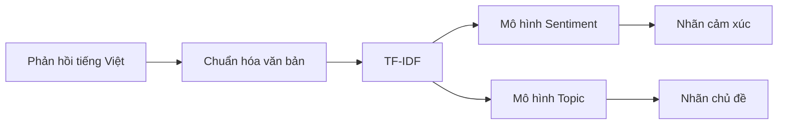
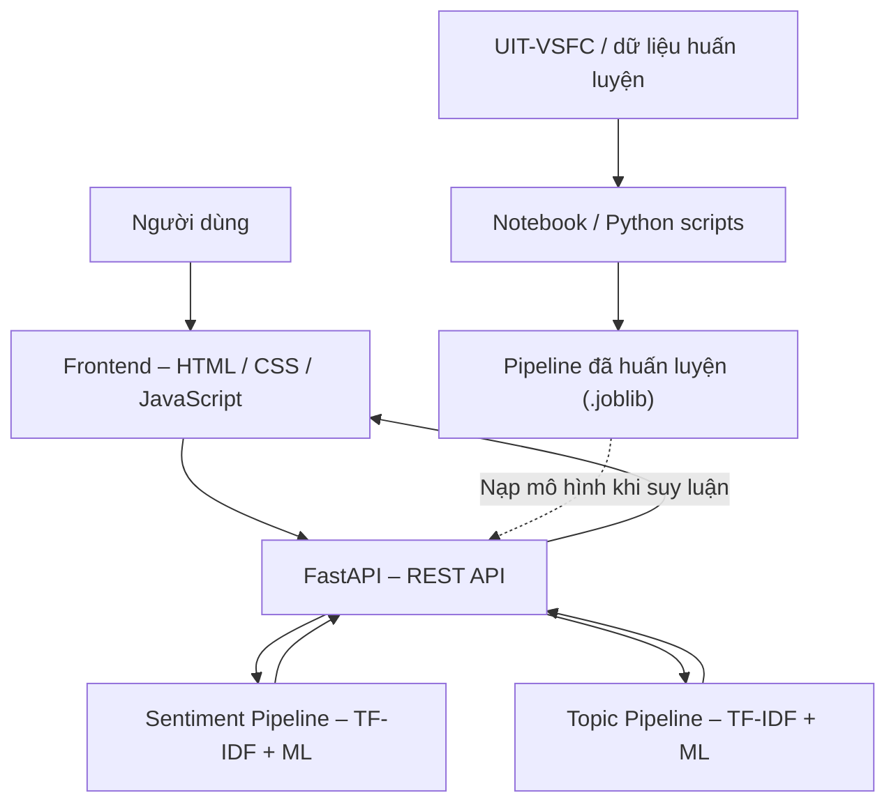

# Student Feedback AI — Tài liệu yêu cầu nghiệp vụ (BRD)

**Hệ thống phân tích cảm xúc và phân loại chủ đề phản hồi sinh viên tiếng Việt bằng Machine Learning**  
*Business Requirements Document — Machine Learning-Based Vietnamese Student Feedback Sentiment and Topic Classification*

<a id="brd-document-control"></a>

## Kiểm soát tài liệu

### Thông tin tài liệu

| Thuộc tính | Nội dung |
| --- | --- |
| Mã tài liệu | BRD-SFAI |
| Phiên bản | 0.5 — Phase 0 v1.0 đã được leader chốt |
| Trạng thái | Đã duyệt Phase 0; ứng dụng chưa triển khai/nghiệm thu |
| Học phần | Cơ sở và Ứng dụng Trí tuệ nhân tạo |
| Nhóm thực hiện | 06 sinh viên; TV1 phụ trách Leader |
| Thời gian dự kiến | 03 tuần / 21 ngày; ngày bắt đầu cần xác nhận |
| Đầu mối quản lý yêu cầu | TV1 — Leader |
| Người phê duyệt | TV1 — Leader, trong phạm vi yêu cầu học phần |
| Nguồn nội dung | README và bản thảo báo cáo dự án đã cung cấp |

### Lịch sử phiên bản

| Phiên bản | Nội dung thay đổi | Trạng thái |
| --- | --- | --- |
| 0.1 | Tổ chức nội dung README thành bản dự thảo BRD. | Bản dự thảo trước khi chuẩn hóa. |
| 0.2 | Chuẩn hóa phân cấp đề mục, bổ sung kiểm soát tài liệu và thuật ngữ; chuyển hướng dẫn cộng tác vào phụ lục. | Chờ rà soát và xác nhận yêu cầu. |
| 0.3 | Thống nhất phân công song song, hướng dẫn từng vai trò, mẫu Phase 0 và khung file trống. | Đã chuẩn bị khung; chưa triển khai/nghiệm thu sản phẩm. |
| 0.4 | Soạn đủ hợp đồng MVP/API/Data/model/môi trường v1.0 và nhật ký quyết định. | Chờ leader duyệt; chưa thay đổi code thành viên. |
| 0.5 | Ghi nhận leader chốt v1.0 ngày 2026-10-19, đồng bộ 5 nhánh và dọn tài liệu/nhánh tạm. | M0 hoàn thành; các thành viên bắt đầu triển khai. |

### Theo dõi rà soát và phê duyệt

| Hoạt động | Đầu mối | Trạng thái | Ngày xác nhận |
| --- | --- | --- | --- |
| Rà soát yêu cầu Phase 0 | TV1 — Leader | Đã rà soát/chốt v1.0 | 2026-10-19 |
| Phê duyệt Phase 0 v1.0 | TV1 — Leader | Đã chốt nội dung trong hội thoại | 2026-10-19 |

> Hiện dự án có bộ tài liệu, hướng dẫn vai trò và khung code/tests/requirements trống; notebook chưa có cell/output. Phase 0 v1.0 đã được leader chốt ngày 2026-10-19; chưa có ứng dụng/model/metrics thật hoặc kết quả nghiệm thu sản phẩm. Mọi chỉ số mô hình phải được đo thực tế.

## Mục lục

**Dành cho nhóm phát triển:** bắt đầu từ [hướng dẫn chung](docs/team-start.md), [phân công song song](docs/team-assignments.md), [hướng dẫn từng vai trò và quyền sở hữu file](docs/function-ownership.md), [quy trình PR](CONTRIBUTING.md) và [roadmap](docs/roadmap/README.md). [Manifest](docs/scaffold-manifest.json) liệt kê các file khởi đầu trống đã tạo.

**Phân công theo chức năng:** Data, Sentiment, Topic, Backend và Frontend có 5 nhánh riêng; xem [quyền sở hữu file](docs/function-ownership.md). [Bộ đặc tả Phase 0 v1.0](docs/specs/README.md) đã được leader chốt; [trang theo dõi Phase 0](docs/roadmap/phase-0-specification.md) ghi bằng chứng duyệt và đầu ra bàn giao.

- [Kiểm soát tài liệu](#brd-document-control)

1. [Bối cảnh và vấn đề nghiệp vụ](#brd-context)
2. [Mục tiêu và tiêu chí thành công](#brd-objectives)
3. [Bên liên quan và trách nhiệm](#brd-stakeholders)
4. [Phạm vi và mức ưu tiên](#brd-scope)
5. [Quy trình nghiệp vụ](#brd-process)
6. [Yêu cầu nghiệp vụ và chức năng](#brd-requirements)
7. [Dữ liệu và quy tắc nghiệp vụ](#brd-data)
8. [Yêu cầu phi chức năng](#brd-quality)
9. [Tiêu chí nghiệm thu và bàn giao](#brd-acceptance)
10. [Kế hoạch và quản lý thay đổi](#brd-plan)
11. [Giả định, phụ thuộc và rủi ro](#brd-risks)
12. [Các nội dung cần xác nhận](#brd-open)
13. [Phụ lục A — Cơ sở lý thuyết và dữ liệu tham khảo](#appendix-a)
14. [Phụ lục B — Thiết kế kỹ thuật dự kiến](#appendix-b)
15. [Phụ lục C — Phương pháp thực nghiệm và kiểm thử](#appendix-c)
16. [Phụ lục D — Repository và môi trường dự kiến](#appendix-d)
17. [Phụ lục E — Báo cáo, kết quả và tài liệu tham chiếu](#appendix-e)
18. [Phụ lục F — Thuật ngữ và quy ước](#appendix-f)

<a id="brd-context"></a>

## 1. Bối cảnh và vấn đề nghiệp vụ

### 1.1. Mục đích tài liệu

BRD xác định mục tiêu, phạm vi, yêu cầu và tiêu chí nghiệm thu của Student Feedback AI, làm cơ sở để nhóm thực hiện rà soát, thống nhất và triển khai. Các nội dung chưa thống nhất được theo dõi tại mục 12; phương án kỹ thuật và hướng dẫn thực hiện được trình bày trong các phụ lục.

### 1.2. Bối cảnh và giải pháp đề xuất

Phản hồi dạng văn bản của sinh viên chứa nhận xét về giảng viên, chương trình đào tạo và điều kiện học tập. Việc đọc và tổng hợp thủ công nhiều phản hồi mất thời gian, gây khó khăn khi nhận diện xu hướng từ câu trả lời mở.

Dự án đề xuất ứng dụng ML/NLP để phân loại một phản hồi tiếng Việt theo hai thuộc tính: **cảm xúc** và **chủ đề**. Kết quả hỗ trợ người dùng xem xét phản hồi; không thay thế quyết định của con người. Trong phạm vi học phần, sản phẩm là ứng dụng demo kèm bằng chứng thực nghiệm và báo cáo.

<a id="brd-objectives"></a>

## 2. Mục tiêu và tiêu chí thành công

| Mã | Mục tiêu | Tiêu chí thành công |
| --- | --- | --- |
| BO-01 | Hỗ trợ nhận diện cảm xúc và chủ đề của phản hồi tiếng Việt. | Website nhận câu mới và trả một nhãn cảm xúc, một nhãn chủ đề từ hai pipeline đã huấn luyện. |
| BO-02 | Đánh giá có cơ sở việc lựa chọn mô hình. | So sánh Naive Bayes, Logistic Regression và Linear SVM cho từng nhiệm vụ trên cùng phân hoạch dữ liệu; có metrics và phân tích lỗi. |
| BO-03 | Bảo đảm kết quả có thể kiểm chứng và tái lập. | Có nguồn dữ liệu, mã xử lý/huấn luyện, cấu hình, pipeline, kết quả đo và minh chứng kiểm thử. |
| BO-04 | Hoàn thành sản phẩm học phần trong 21 ngày. | Bàn giao code, demo, báo cáo và presentation theo yêu cầu học phần. |
| BO-05 | Hỗ trợ tổng hợp nhiều phản hồi nếu đủ thời gian. | CSV xuất đủ kết quả; thống kê Dashboard khớp dữ liệu vừa phân tích. |

Chưa có ngưỡng Accuracy/Macro F1 tối thiểu hoặc mục tiêu định lượng về thời gian tiết kiệm. Không tự đặt ngưỡng nghiệm thu khi chưa thống nhất; ưu tiên Macro F1 trên validation để lựa chọn mô hình theo phương pháp đã đề xuất.

<a id="brd-stakeholders"></a>

## 3. Bên liên quan và trách nhiệm

### 3.1. Các bên liên quan

| Bên liên quan | Vai trò / nhu cầu |
| --- | --- |
| Người dùng ứng dụng demo | Nhập phản hồi, xem nhãn; phân tích CSV và xem thống kê nếu chức năng được triển khai. Nhóm người dùng nghiệp vụ cụ thể cần xác nhận. |
| Giảng viên học phần | Đánh giá phương pháp, kết quả thực nghiệm, demo và báo cáo theo yêu cầu học phần. |
| Nhóm 06 sinh viên | Thực hiện, kiểm thử và cung cấp minh chứng đóng góp. |
| TV1 — Leader | Quản lý yêu cầu, điều phối tích hợp và rà soát sản phẩm bàn giao. |

### 3.2. Phân công trách nhiệm

| Vai trò | Công việc chính | Bàn giao dự kiến | Nhánh làm việc gợi ý |
| --- | --- | --- | --- |
| **TV1 – Leader** | Yêu cầu, quản lý `main`, duyệt PR, tích hợp, kiểm thử, tổng hợp báo cáo/PPT. | Checklist tích hợp, tài liệu, báo cáo chung. | `feature/integration` khi cần sửa code |
| **TV2 – Data** | Kiểm tra UIT-VSFC, EDA, chuẩn hóa văn bản, đối chiếu nhãn. | Notebook EDA, mã xử lý dữ liệu, thống kê. | `feature/data-preprocessing` |
| **TV3 – Sentiment** | Huấn luyện và so sánh 3 mô hình cảm xúc. | Sentiment pipeline, metrics, confusion matrix. | `feature/sentiment-model` |
| **TV4 – Topic** | Huấn luyện và so sánh 3 mô hình chủ đề. | Topic pipeline, metrics, confusion matrix. | `feature/topic-model` |
| **TV5 – Backend** | FastAPI, API dự đoán, batch CSV, xử lý lỗi. | API chạy được, test và tài liệu endpoint. | `feature/backend-api` |
| **TV6 – Frontend** | Giao diện phân tích, CSV, Dashboard, kết nối API. | Website và ảnh demo thực tế. | `feature/frontend-dashboard` |

<a id="brd-scope"></a>

## 4. Phạm vi và mức ưu tiên

| Phân loại | Nội dung |
| --- | --- |
| P0 — Bắt buộc | Xác minh dữ liệu, EDA, hai nhiệm vụ phân loại, so sánh ba thuật toán/nhiệm vụ, đánh giá ML, lưu/tải pipeline, web phân tích một câu, kiểm thử và báo cáo. |
| P1 — Nếu đủ thời gian | Phân tích CSV, xuất kết quả, Dashboard; hiển thị kết quả đánh giá ML trên web, cải thiện giao diện và kiểm thử mở rộng. |
| P2 — Ngoài phạm vi bắt buộc của MVP | Chatbot/LLM, ABSA, PhoBERT/Deep Learning, GIS, tài khoản người dùng, cơ sở dữ liệu riêng, lịch sử phân tích và triển khai production/cloud. |

Mỗi câu chỉ nhận **một nhãn cảm xúc chính và một nhãn chủ đề chính**. Các hướng phát triển P2 chỉ được xem xét sau học phần hoặc khi phạm vi được thống nhất lại.

<a id="brd-process"></a>

## 5. Quy trình nghiệp vụ

### 5.1. Phân tích một phản hồi

1. Người dùng nhập câu phản hồi tiếng Việt trên website.
2. Hệ thống kiểm tra đầu vào và mức sẵn sàng của mô hình.
3. Nếu hợp lệ, hệ thống thực hiện suy luận bằng hai pipeline đã huấn luyện.
4. Website hiển thị nhãn cảm xúc và chủ đề; nếu không thể xử lý, thông báo lỗi rõ ràng.

### 5.2. Phân tích hàng loạt — phạm vi P1

1. Người dùng tải CSV có cột `text`.
2. Hệ thống kiểm tra định dạng và dữ liệu, dự đoán cho từng dòng hợp lệ theo quy tắc được thống nhất.
3. Người dùng xem và xuất bảng kết quả.
4. Dashboard tổng hợp phân bố cảm xúc/chủ đề của dữ liệu vừa phân tích.

Hợp đồng P1 dự phòng đã được duyệt tại [API v1.0](docs/specs/api-contract.md): 2 MiB/1000 record, lỗi từng dòng và summary; chỉ triển khai sau khi leader cho phép P1; việc chốt đặc tả không tự bật phạm vi này.

### 5.3. Ví dụ nghiệp vụ

| Phản hồi | Cảm xúc kỳ vọng | Chủ đề kỳ vọng |
| --- | --- | --- |
| Giảng viên giảng bài rất dễ hiểu. | Tích cực | Giảng viên |
| Máy chiếu thường xuyên bị hỏng. | Tiêu cực | Cơ sở vật chất |
| Môn học có ba tín chỉ. | Trung tính | Chương trình đào tạo |

Các nhãn trên chỉ minh họa mong muốn, không phải kết quả đã được mô hình kiểm chứng.

<a id="brd-requirements"></a>

## 6. Yêu cầu nghiệp vụ và chức năng

### 6.1. Yêu cầu nghiệp vụ

| Mã | Yêu cầu | Mục tiêu | Ưu tiên |
| --- | --- | --- | --- |
| BR-01 | Phân loại phản hồi tiếng Việt theo cảm xúc và chủ đề. | BO-01 | P0 |
| BR-02 | Lựa chọn mô hình dựa trên thí nghiệm có thể so sánh và kiểm chứng. | BO-02, BO-03 | P0 |
| BR-03 | Cung cấp ứng dụng demo sử dụng mô hình thực, cùng tài liệu và bằng chứng học thuật. | BO-03, BO-04 | P0 |
| BR-04 | Tổng hợp tập phản hồi để người dùng xem phân bố nhãn. | BO-05 | P1 |

### 6.2. Yêu cầu chức năng

| Mã | Mã cũ | Yêu cầu | Liên kết | Ưu tiên |
| --- | --- | --- | --- | --- |
| FR-01 | F01 | Nhập một phản hồi, gửi đến API và hiển thị hai nhãn từ pipeline ML thực. | BR-01, BR-03 | P0 |
| FR-02 | — | Từ chối câu rỗng/chỉ có khoảng trắng; báo rõ khi mô hình chưa sẵn sàng. | BR-01, BR-03 | P0 |
| FR-03 | F02 | Nhận CSV có cột `text`, dự đoán từng dòng và xuất kết quả. | BR-04 | P1 |
| FR-04 | F03 | Hiển thị tần suất nhãn cảm xúc/chủ đề của dữ liệu vừa phân tích. | BR-04 | P1 |
| FR-05 | F04 | Cung cấp bảng đánh giá ML, Confusion Matrix và phân tích lỗi trong báo cáo. | BR-02, BR-03 | P0; hiển thị trên web thuộc P1 |
| FR-06 | — | Cung cấp trạng thái dịch vụ và mức sẵn sàng của model qua API health. | BR-03 | P0, hỗ trợ vận hành demo |

<a id="brd-data"></a>

## 7. Dữ liệu và quy tắc nghiệp vụ

| Mã | Quy tắc / yêu cầu |
| --- | --- |
| DR-01 | Dự kiến sử dụng UIT-VSFC; TV2 phải xác minh nguồn, quyền sử dụng, phiên bản, cột, số dòng và phân chia tập trước khi huấn luyện. |
| DR-02 | Kiểm tra giá trị rỗng, trùng lặp, phân bố lớp và bảng mã nhãn; không giả định ý nghĩa của mã `0/1/2/3`. |
| DR-03 | Lưu thông tin phiên bản thư viện, random seed nếu dùng, cách chia dữ liệu và tham số thí nghiệm. |
| RULE-01 | Cảm xúc gồm Tiêu cực, Trung tính, Tích cực; chủ đề gồm Giảng viên, Chương trình đào tạo, Cơ sở vật chất, Khác. Mã kỹ thuật phải đối chiếu dataset. |
| RULE-02 | Hai nhiệm vụ phân loại có giám sát sử dụng hai pipeline độc lập; mỗi nhiệm vụ trả một nhãn chính. |
| RULE-03 | Các bước `fit` chỉ học trên train; validation dùng chọn phương án; test dùng đánh giá cuối. Không điều chỉnh lặp lại theo điểm test. |
| RULE-04 | Lưu toàn bộ pipeline đã fit; tiền xử lý và vectorizer khi suy luận phải đúng với thí nghiệm. |
| RULE-05 | Không hard-code dự đoán, điểm tin cậy giả hoặc dùng mockup làm minh chứng sản phẩm đã hoạt động. |
| RULE-06 | Dữ liệu demo, nhãn minh họa và kết quả thực nghiệm phải được phân biệt rõ trong tài liệu/báo cáo. |

<a id="brd-quality"></a>

## 8. Yêu cầu phi chức năng

| Mã | Nhóm | Yêu cầu | Cách kiểm chứng |
| --- | --- | --- | --- |
| NFR-01 | Tính nhất quán | Notebook và API sử dụng đúng pipeline đã chọn. | Tải lại pipeline và đối chiếu xử lý/suy luận. |
| NFR-02 | Khả năng tái lập | Có mã, cấu hình, môi trường và hướng dẫn để chạy lại thí nghiệm. | Thực hiện theo hướng dẫn và lưu kết quả/log. |
| NFR-03 | Minh bạch lỗi | Đầu vào không hợp lệ hoặc thiếu mô hình phải có thông báo rõ. | Kiểm thử các tình huống lỗi trong phụ lục C. |
| NFR-04 | Bảo vệ dữ liệu | Không công bố `.env`, API key, thông tin cá nhân; kiểm tra quyền phân phối dataset/model. | Rà soát nội dung trước khi commit/push và bàn giao. |
| NFR-05 | Tính kiểm chứng | Metrics, biểu đồ và ảnh demo phải có bằng chứng thực tế tương ứng. | Đối chiếu notebook/script, file metrics, log và ảnh chạy thật. |

Đặc tả v1.0 quy định input tối đa 5000 Unicode code point, CSV P1 tối đa 2 MiB/1000 record và Chrome/Edge desktop stable tại thời điểm nghiệm thu. Đây là lựa chọn thiết kế đã duyệt, không phải số đo; không đặt SLA/số người dùng đồng thời mới ngoài BRD. Xem [MVP](docs/specs/mvp.md) và [API](docs/specs/api-contract.md).

<a id="brd-acceptance"></a>

## 9. Tiêu chí nghiệm thu và bàn giao

### 9.1. Ma trận nghiệm thu

| Mã | Yêu cầu liên quan | Điều kiện đạt | Minh chứng |
| --- | --- | --- | --- |
| AC-01 | DR-01, DR-02 | Xác minh nguồn, bảng mã, chia tập và chất lượng dữ liệu; có EDA. | Notebook, thống kê và biểu đồ. |
| AC-02 | BR-02, FR-05, RULE-03 | So sánh 3 thuật toán cho mỗi nhiệm vụ; chọn bằng validation; báo cáo test với Accuracy, Macro Precision/Recall/F1, chỉ số từng lớp và Confusion Matrix. | Hai bảng thí nghiệm, metrics, cấu hình và phân tích lỗi. |
| AC-03 | FR-01, NFR-01 | Nhập câu mới trên web và nhận hai nhãn từ pipeline được tải lại thành công. | Demo, log API, ảnh chạy thật. |
| AC-04 | FR-02, NFR-03 | Câu rỗng/khoảng trắng bị từ chối; thiếu model được báo chưa sẵn sàng. | Kết quả kiểm thử. |
| AC-05 | FR-03 | CSV hợp lệ trả số dòng kết quả khớp đầu vào; CSV sai định dạng/thiếu `text` có lỗi rõ. | File mẫu, file xuất và log; áp dụng nếu triển khai P1. |
| AC-06 | FR-04 | Thống kê Dashboard khớp bảng kết quả. | Đối chiếu số lượng từng nhãn; áp dụng nếu triển khai P1. |
| AC-07 | FR-06 | API health thể hiện trạng thái dịch vụ và mức sẵn sàng của model. | Phản hồi API khi có/thiếu model. |
| AC-08 | BR-03, NFR-02, NFR-04, NFR-05 | Có code, hướng dẫn tái lập, lịch sử đóng góp, report và presentation dùng bằng chứng thật. | Bộ tài liệu bàn giao và demo cuối kỳ. |

### 9.2. Sản phẩm bàn giao và yêu cầu học phần

#### 9.2.1. Checklist bàn giao cuối kỳ

- [ ] Dataset được kiểm tra nguồn, cột, mã nhãn và chia tập rõ ràng.
- [ ] Notebook EDA có biểu đồ phân bố sentiment/topic.
- [ ] Có baseline và so sánh ba thuật toán cho **mỗi** nhiệm vụ.
- [ ] Có Accuracy, Macro F1, các thước đo liên quan và hai Confusion Matrix trên test.
- [ ] Lưu và tải lại pipeline ML thực sự được huấn luyện.
- [ ] Website phân tích **câu mới** thành công qua FastAPI.
- [ ] Có kiểm thử đầu vào rỗng và trạng thái thiếu model.
- [ ] CSV/Dashboard hoạt động (nếu triển khai trong phạm vi đã chốt).
- [ ] Repository có README, nguồn code, commit/PR và hướng dẫn tái lập.
- [ ] Hoàn thiện báo cáo `.docx`/`.pdf` và PowerPoint có minh chứng thật.

#### 9.2.2. Bố cục báo cáo theo yêu cầu giảng viên

Báo cáo phải theo 6 phần nghiên cứu:

1. **Goal and Motivation:** mục tiêu, động cơ và bài toán.
2. **Background:** kiến thức nền liên quan.
3. **Proposed Model:** mô hình đề xuất và thiết kế hệ thống.
4. **Technique / Method:** cách chuẩn bị dữ liệu, huấn luyện, đánh giá và xây dựng ứng dụng.
5. **Result:** số liệu, so sánh, ảnh chạy thật và những công việc nhóm đã thực hiện.
6. **Conclusion & Future Work:** kết luận dựa trên bằng chứng, hạn chế và hướng phát triển.

**Giới hạn báo cáo cập nhật:** tối đa **80 trang**, định dạng Word hoặc PDF. Nhóm nộp **report + presentation** qua đường dẫn Classroom theo hướng dẫn giảng viên; thông tin gửi cần ghi rõ **tên học phần, tên đề tài và tên nhóm**. Theo slide học phần trước đó, thuyết trình dự kiến 20–30 phút và 10 phút hỏi đáp (nếu giảng viên không thông báo lịch mới).

<a id="brd-plan"></a>

## 10. Kế hoạch và quản lý thay đổi

### 10.1. Kế hoạch thực hiện

Kế hoạch phát triển được chia thành **7 phase (Phase 0–6)**, mỗi phase có đầu việc, phụ thuộc, sản phẩm bàn giao và tiêu chí hoàn thành riêng. Xem [lộ trình chi tiết](docs/roadmap/README.md); bắt đầu từ [Phase 0 — Chốt phạm vi và đặc tả](docs/roadmap/phase-0-specification.md). Khung file đã được chuẩn bị; các phase sản phẩm chưa triển khai/nghiệm thu. Cả 5 vai trò làm phần độc lập song song sau M0, chỉ chờ ở bước cần đầu ra thật. Phase 5 (CSV/Dashboard) thuộc P1 và chỉ thực hiện khi đủ thời gian.

| Giai đoạn | Công việc song song | Mốc phải đạt |
| --- | --- | --- |
| **Tuần 1 · Ngày 1–7** | Hoàn thiện khung repo/API, kiểm tra dataset và EDA, baseline cho sentiment/topic, giao diện khởi tạo. | Repo chạy được, dataset đọc được, có baseline và minh chứng. |
| **Tuần 2 · Ngày 8–14** | So sánh 3 thuật toán/nhiệm vụ, chọn pipeline, tích hợp Backend–Frontend, kiểm tra trên test. | Website dự đoán câu mới từ ML thật, có metrics và Confusion Matrix. |
| **Tuần 3 · Ngày 15–21** | Hoàn thiện CSV/Dashboard nếu kịp, kiểm thử, cập nhật báo cáo và slide, diễn tập. | Demo ổn định, code, báo cáo và PowerPoint có minh chứng. |

**Thứ tự ưu tiên khi thiếu thời gian:**

1. **P0:** Dữ liệu hợp lệ + hai mô hình ML thật + đo kiểm + web dự đoán một câu.
2. **P1:** CSV, Dashboard, trải nghiệm giao diện và kiểm thử mở rộng.
3. **P2:** PhoBERT/ABSA, database, tài khoản, deploy cloud – ngoài phạm vi bắt buộc.

### 10.2. Quản lý thay đổi yêu cầu

Quy trình theo cơ chế Issues/PR của nhóm: ghi rõ yêu cầu và tiêu chí nghiệm thu trong Issue, xác định ảnh hưởng tới phạm vi/tiến độ, để Leader rà soát trước khi tích hợp. Khi thay đổi được thống nhất, cập nhật mã yêu cầu và các tiêu chí nghiệm thu liên quan trong BRD. Người phê duyệt chính thức và thời điểm chốt BRD cần xác nhận.

<a id="brd-risks"></a>

## 11. Giả định, phụ thuộc và rủi ro

Các rủi ro dưới đây được tổng hợp từ giới hạn và điều kiện đã nêu trong README nguồn.

| Mã | Giả định / phụ thuộc / rủi ro | Ảnh hưởng và cách xử lý dự kiến |
| --- | --- | --- |
| R-01 | Thời gian 21 ngày, nhóm 06 sinh viên. | Ưu tiên P0; chỉ triển khai CSV/Dashboard khi đủ thời gian. |
| R-02 | Quyền sử dụng, nguồn và bảng mã UIT-VSFC chưa được xác minh. | TV2 xác minh trước huấn luyện hoặc phân phối dữ liệu. |
| R-03 | Mất cân bằng nhãn và khác biệt dữ liệu giữa các trường. | Phân tích từng lớp, Macro F1 và giới hạn khả năng khái quát. |
| R-04 | Một câu có nhiều chủ đề/cảm xúc trái chiều. | Công bố giới hạn một nhãn chính; xem ABSA là hướng phát triển. |
| R-05 | API phụ thuộc pipeline và hợp đồng nhãn từ nhóm ML. | TV3–TV6 cùng Leader thống nhất giao diện trước tích hợp; báo chưa sẵn sàng khi thiếu model. |
| R-06 | Python, dependencies và entrypoint chưa được kiểm chứng cho bản triển khai mới. | Xác nhận môi trường tương thích và cập nhật hướng dẫn khi có code thực tế. |
| R-07 | Minh chứng từ bản thảo hoặc bộ khung cũ không phản ánh trạng thái hiện tại. | Chỉ nghiệm thu dựa trên kết quả chạy và thí nghiệm của bản triển khai mới. |

<a id="brd-open"></a>

## 12. Các nội dung cần xác nhận

Nguồn yêu cầu ban đầu và đầu mối được giữ ở bảng dưới. Cách xử lý từng TBD trong Phase 0 đã được ghi tại [nhật ký quyết định v1.0](docs/decisions.md); API/giới hạn/môi trường đã được chốt trong bộ đặc tả v1.0. Quyền dùng dữ liệu, tên thành viên và lịch thực tế chưa được tự xác nhận thay nhóm.

| Mã | Nội dung | Đầu mối dự kiến |
| --- | --- | --- |
| TBD-01 | Tên thành viên, nhóm, người phê duyệt BRD, ngày bắt đầu và hạn nộp thực tế. | Leader / giảng viên |
| TBD-02 | URL, trích dẫn, giấy phép, phiên bản, số dòng và bảng mã dataset. | TV2 |
| TBD-03 | Field API, giá trị nhãn, định dạng batch/export và quy tắc dòng CSV lỗi. | TV3–TV6 / Leader |
| TBD-04 | Có đưa CSV/Dashboard vào phạm vi cam kết hay giữ ở mức nếu đủ thời gian. | Leader / nhóm |
| TBD-05 | Ngưỡng chất lượng ML nếu cần; giới hạn đầu vào/file và yêu cầu hiệu năng. | Leader / nhóm |
| TBD-06 | Phiên bản Python, dependencies, entrypoint và cách phục vụ frontend. | TV3–TV6 |
| TBD-07 | Đối tượng người dùng nghiệp vụ cụ thể và nguồn phản hồi demo mới. | Leader / nhóm |
| TBD-08 | Lịch trình thuyết trình, đường dẫn Classroom và yêu cầu mới nhất của giảng viên. | Leader / giảng viên |

<a id="appendix-a"></a>

## Phụ lục A — Cơ sở lý thuyết và dữ liệu tham khảo

### A.1. Cơ sở lý thuyết

| Khái niệm | Vai trò trong dự án |
| --- | --- |
| **AI / ML** | Học từ dữ liệu có nhãn để suy luận nhãn cho phản hồi chưa thấy. |
| **NLP** | Chuẩn hóa và biểu diễn câu tiếng Việt để máy tính xử lý. |
| **Supervised Classification** | Phân loại cảm xúc và chủ đề thành các nhãn xác định. |
| **TF-IDF** | Chuyển câu thành vector trọng số từ/ngữ. |
| **Multinomial Naive Bayes** | Mốc đối chứng (baseline) đơn giản và nhanh. |
| **Logistic Regression** | Bộ phân loại tuyến tính để so sánh. |
| **Linear SVM** | Bộ phân loại tuyến tính tối ưu biên phân tách. |

### A.2. Dữ liệu nghiên cứu: UIT-VSFC

Nhóm **dự kiến** sử dụng **UIT-VSFC (Vietnamese Students' Feedback Corpus)**, bộ dữ liệu phản hồi sinh viên tiếng Việt có nhãn cảm xúc và chủ đề.

Theo bản mô tả trong báo cáo, số lượng tham khảo là:

| Tập | Số câu tham khảo | Mục đích |
|---|---:|---|
| Train | 11.426 | Huấn luyện vectorizer và mô hình. |
| Validation | 1.583 | So sánh mô hình và chọn siêu tham số. |
| Test | 3.166 | Đánh giá cuối cùng, sau khi chốt phương pháp. |
| **Tổng** | **16.175** | **Phải xác minh bằng phiên bản dataset thực tế tải về.** |

**Trước khi huấn luyện, TV2 cần xác nhận:** nguồn/phép sử dụng dữ liệu, số dòng mỗi tập, tên cột, mã hóa nhãn, nhãn cảm xúc/chủ đề, giá trị rỗng, trùng lặp và phân bố lớp. **Không tự giả định rằng mã `0/1/2/3` tương ứng với nhãn nào khi chưa đối chiếu nguồn dữ liệu.**

<a id="appendix-b"></a>

## Phụ lục B — Thiết kế kỹ thuật dự kiến

### B.1. Quy trình dự đoán



Hai nhiệm vụ có thể cùng dùng hàm chuẩn hóa văn bản, nhưng **TF-IDF/vectorizer và bộ phân loại cần được lưu đúng theo pipeline đã huấn luyện**. Mô hình phục vụ API phải sử dụng đúng cách xử lý như trong thí nghiệm.

### B.2. Kiến trúc ứng dụng



**Ngăn xếp công nghệ dự kiến**

- **Data/ML:** Python, pandas, NumPy, scikit-learn; notebook trong Jupyter hoặc Google Colab.
- **Backend:** FastAPI, Python; đọc các pipeline đã lưu.
- **Frontend:** HTML, CSS, JavaScript; biểu đồ có thể sử dụng Chart.js.
- **Kiểm thử:** pytest (nếu được thiết lập trong repository).
- **Cộng tác:** Git, GitHub, feature branch và Pull Request.
- **Cơ sở dữ liệu:** Không bắt buộc ở MVP; việc lưu lịch sử chỉ thực hiện khi có yêu cầu phù hợp.

### B.3. Các chức năng sản phẩm

| Mã | Chức năng | Ưu tiên | Kết quả mong đợi |
| --- | --- | --- | --- |
| **F01** | Phân tích một câu phản hồi | **Bắt buộc** | Gửi văn bản, nhận hai nhãn từ pipeline ML thực. |
| **F02** | Phân tích tệp CSV | Mục tiêu nếu đủ thời gian | Nhận CSV có cột `text`, dự đoán từng dòng, xuất dữ liệu kết quả. |
| **F03** | Dashboard thống kê | Mục tiêu nếu đủ thời gian | Biểu đồ tần suất nhãn của dữ liệu vừa phân tích. |
| **F04** | Kết quả đánh giá ML | **Bắt buộc trong báo cáo** | Bảng metrics, Confusion Matrix, phân tích lỗi; đưa lên web nếu kịp. |

**Minh họa giao diện dự kiến:** Trang *Phân tích AI* gồm ô nhập phản hồi và khu vực hiển thị 2 nhãn; trang *Phân tích CSV* có khu vực tải file và xuất kết quả; trang *Dashboard* có số lượng/phân bố cảm xúc và chủ đề. Những hình giao diện trong báo cáo là **mockup**, chưa phải ảnh sản phẩm chạy thực tế.

### B.4. Hợp đồng API dự kiến

[API v1.0](docs/specs/api-contract.md) là hợp đồng chi tiết đã duyệt; các ví dụ dưới đây chỉ minh họa và chưa chứng minh endpoint đã triển khai. Backend/Frontend triển khai theo cùng JSON/error envelope và contract_version.

| Phương thức | Endpoint | Chức năng |
| --- | --- | --- |
| `GET` | `/api/health` | Kiểm tra trạng thái dịch vụ và mức sẵn sàng của model. |
| `POST` | `/api/predict` | Phân loại một phản hồi (`JSON`). |
| `POST` | `/api/predict-batch` | Phân loại nhiều phản hồi từ CSV (cột `text`). |

**Ví dụ yêu cầu `POST /api/predict`:**

```json
{
  "text": "Giảng viên giảng bài rất dễ hiểu."
}
```

**Ví dụ cấu trúc phản hồi mong muốn (minh họa, không phải kết quả model đã chạy):**

```json
{
  "sentiment": "positive",
  "topic": "lecturer",
  "contract_version": "1.0"
}
```

Tên field, nhãn và batch đã được leader chốt trong bộ đặc tả v1.0; các thành viên dùng cùng phiên bản để triển khai giao diện kết nối. **Không hard-code nhãn dự đoán hoặc điểm tin cậy giả.** Nếu chưa có mô hình, API phải báo rõ *model chưa sẵn sàng* thay vì giả lập kết quả là thật.

<a id="appendix-c"></a>

## Phụ lục C — Phương pháp thực nghiệm và kiểm thử

### C.1. Quy trình thực nghiệm

1. **Thu thập và kiểm tra dữ liệu:** truy xuất đúng bản UIT-VSFC, xác minh cột, mã nhãn và phân chia tập.
2. **EDA và tiền xử lý:** kiểm tra phân bố nhãn, câu rỗng, trùng lặp, chuẩn hóa Unicode và khoảng trắng; không tùy tiện loại bỏ từ chứa sắc thái cảm xúc.
3. **Biểu diễn TF-IDF:** thử unigram/bigram và các tham số thích hợp.
4. **Huấn luyện:** so sánh ba thuật toán trên **cùng phân hoạch train/validation/test** cho từng nhiệm vụ.
5. **Chọn mô hình:** ưu tiên `Macro F1` trên validation, cân nhắc thêm độ ổn định và thời gian suy luận.
6. **Đánh giá cuối:** báo cáo `Accuracy`, `Macro Precision`, `Macro Recall`, `Macro F1`, chỉ số từng lớp và `Confusion Matrix` trên test.
7. **Lưu pipeline:** ví dụ `sentiment_pipeline.joblib` và `topic_pipeline.joblib` (tên file cuối cùng theo code thực tế).
8. **Tích hợp & kiểm thử:** nối API với giao diện; lưu minh chứng chức năng và kết quả thí nghiệm.

> **Quy tắc chống data leakage:** Các bước có `fit` như TF-IDF, chọn đặc trưng và ước lượng tham số chỉ học trên **train**; dùng **validation** để chọn phương án, và giữ **test** cho đánh giá cuối. Không tinh chỉnh mô hình lặp đi lặp lại dựa trên điểm test.

### C.2. Đánh giá mô hình

Nhóm thực hiện **hai bảng thí nghiệm riêng**: sentiment và topic. Mỗi bảng so sánh `Naive Bayes`, `Logistic Regression` và `Linear SVM` với điều kiện dữ liệu tương đương.

Ngoài kết quả trung bình, cần phân tích:

- Những nhãn có ít mẫu và những cặp nhãn hay bị nhầm.
- Ít nhất một số câu dự đoán sai có giải thích hợp lý dựa trên dữ liệu/mô hình.
- Trường hợp câu chứa **nhiều chủ đề hoặc cảm xúc trái chiều**, chẳng hạn: “Giảng viên nhiệt tình nhưng phòng học nóng.”
- Giới hạn khi áp dụng dữ liệu nghiên cứu cho phản hồi ở một trường khác.

### C.3. Kiểm thử chức năng

| Tình huống | Hành vi mong đợi |
| --- | --- |
| Câu hợp lệ, đã có model | Trả về JSON hợp lệ từ hai pipeline. |
| Câu rỗng hoặc chỉ có khoảng trắng | Thông báo lỗi đầu vào; không chạy suy luận. |
| File model chưa tồn tại | Trả trạng thái **chưa sẵn sàng**. |
| CSV thiếu cột `text` hoặc sai định dạng | Trả lỗi rõ ràng, không xuất dữ liệu giả. |
| CSV hợp lệ và có model | Số dòng kết quả khớp đầu vào; thống kê Dashboard khớp bảng. |

Các minh chứng cần lưu gồm log kiểm thử, hình chạy thật, notebook, file metrics và lịch sử commit/PR.

<a id="appendix-d"></a>

## Phụ lục D — Repository và môi trường dự kiến

### D.1. Cấu trúc khởi đầu hiện có

Các thư mục và file khung đã được tạo. Code/tests/requirements còn trống; notebook là notebook rỗng hợp lệ. Đây chưa phải bản triển khai ứng dụng. Danh sách chính xác và chủ sở hữu có trong [manifest](docs/scaffold-manifest.json).

```text
student-feedback-ai/
├── backend/                 # TV5: main/config/schema/model_service/routes
├── frontend/                # TV6: index/styles/app/api, P1 batch/dashboard
├── ml/                      # TV2: data/preprocessing/labels
│                            # TV3: train/evaluate/predict_sentiment
│                            # TV4: train/evaluate/predict_topic
├── data/raw/                # Dataset local, ignore trừ .gitkeep
├── data/processed/          # Dataset local, ignore trừ .gitkeep
├── models/                  # Chưa có artifact; có hướng dẫn bàn giao
├── notebooks/               # 3 notebook rỗng theo vai trò
├── tests/                   # Tests phần riêng, frontend và integration
├── requirements/            # Dependencies riêng của Data/ML/Backend
├── docs/specs/              # Mẫu đặc tả để leader chốt Phase 0
├── docs/{data,sentiment,topic,backend,frontend}/
│                            # Hướng dẫn, tài liệu và phần báo cáo riêng
├── docs/roadmap/            # Mốc phát triển/nghiệm thu
├── reports/                 # Nơi lưu kết quả thật, hiện có marker thư mục
├── .github/                 # CODEOWNERS, mẫu Issue/PR
├── CONTRIBUTING.md
└── README.md                # BRD
```

### D.2. Môi trường và cách chạy

[Môi trường v1.0](docs/specs/environment.md) quy định CPython 3.13.x 64-bit và bộ constraints chung; leader kiểm chứng/khóa dependencies ở Phase 1 và duy trì [hướng dẫn phát triển](docs/development.md). Hiện requirements/config trống, `backend/main.py` chưa có ứng dụng, giao diện/tests chưa có nội dung; chưa có lệnh khởi động được nghiệm thu.

Mỗi thành viên đọc hướng dẫn phần mình: [Data](docs/data/README.md), [Sentiment](docs/sentiment/README.md), [Topic](docs/topic/README.md), [Backend](docs/backend/README.md), [Frontend](docs/frontend/README.md). Không coi cài requirements trống, notebook rỗng hoặc pytest không thu thập bài nào là đã hoàn thành phần việc.

### D.3. Bảo vệ dữ liệu và khả năng tái lập

- Không đẩy các file `.env`, môi trường ảo, thông tin cá nhân hoặc API key lên repository.
- Kiểm tra giấy phép và điều kiện sử dụng UIT-VSFC trước khi lưu/phân phối bộ dữ liệu gốc.
- Ghi phiên bản thư viện, cách chia dữ liệu, random seed (nếu dùng) và tham số mô hình.
- Lưu **toàn bộ pipeline** đã fit, không chỉ bộ phân loại, để kết quả notebook và API nhất quán.
- Mọi kết quả Accuracy/F1 và biểu đồ trong báo cáo phải có mã sinh ra và bằng chứng kiểm thử tương ứng.

### D.4. Quy trình cộng tác

Xem [quy trình GitHub và bảo vệ nhánh](CONTRIBUTING.md), [phân công 5 thành viên](docs/team-assignments.md) và [mẫu Pull Request](.github/pull_request_template.md). Quy tắc bảo vệ phải được bật trên GitHub; file tài liệu và CODEOWNERS tự chúng chưa chặn push trực tiếp.

1. Leader duy trì `main` ở trạng thái ổn định, dùng `develop` để tích hợp; tạo **GitHub Issues** cho từng đầu việc có tiêu chí nghiệm thu.
2. Mỗi người checkout đúng nhánh chức năng leader đã tạo và đồng bộ phần đã duyệt từ `origin/develop`; chỉ sửa file thuộc phạm vi được giao.
3. Thành viên commit/push nhánh riêng và tạo **Pull Request vào `develop`** khi có phần code có thể review.
4. Leader xem diff, yêu cầu test hoặc sửa, chỉ merge sau khi đạt tiêu chí. Khi bản tích hợp ổn định, mở PR từ `develop` vào `main` để leader duyệt; người mở PR này phải khác leader nếu yêu cầu approval của leader duy nhất.
5. Nếu thành viên gặp khó khăn, Leader hỗ trợ hoặc tiếp quản từ code đã push; **ghi nhận đúng đóng góp thực tế** trong báo cáo cuối kỳ.

```bash
# Ví dụ dành cho thành viên đã clone repository

git fetch origin
git switch --track origin/feature/sentiment-model

# Sau khi làm và tự kiểm tra
git add .
git commit -m "Implement sentiment baseline"
git push -u origin feature/sentiment-model
# Sau đó mở Pull Request trên GitHub vào nhánh develop và yêu cầu leader review
```

> Trước khi `git add`, bảo đảm không có dữ liệu riêng tư, `.env`, `.venv`, cache, dataset hoặc model lớn không được phép công bố. Không trực tiếp push lên `main` hoặc `develop`; sau approval, cập nhật nhánh đích bằng merge PR.

<a id="appendix-e"></a>

## Phụ lục E — Báo cáo, kết quả và tài liệu tham chiếu

### E.1. Trạng thái và bảng kết quả chờ đo

Đã chuẩn bị lại khung file trống và tài liệu làm việc song song cho 5 vai trò. Chưa có minh chứng huấn luyện hoặc chạy end-to-end. Dataset/EDA, mô hình, API, website, CSV/Dashboard và báo cáo hoàn chỉnh đều cần kết quả thực tế trước nghiệm thu; xem [bảng nghiệm thu](docs/acceptance.md).

**Bảng kết quả – Sentiment (chờ đo):**

| Thuật toán | Accuracy test | Macro F1 test |
| --- | --- | --- |
| Multinomial Naive Bayes | Chưa đo | Chưa đo |
| Logistic Regression | Chưa đo | Chưa đo |
| Linear SVM | Chưa đo | Chưa đo |

**Bảng kết quả – Topic (chờ đo):**

| Thuật toán | Accuracy test | Macro F1 test |
| --- | --- | --- |
| Multinomial Naive Bayes | Chưa đo | Chưa đo |
| Logistic Regression | Chưa đo | Chưa đo |
| Linear SVM | Chưa đo | Chưa đo |

Sau khi có thí nghiệm thực, cập nhật bảng trên bằng số liệu thật; thêm thông số huấn luyện, thời gian chạy, ma trận nhầm lẫn của từng nhiệm vụ và dẫn tới notebook/biểu đồ tương ứng.

### E.2. Kịch bản demo trước giảng viên (dự kiến)

1. Mở notebook cho thấy dữ liệu, TF-IDF, mã huấn luyện và bảng so sánh thuật toán.
2. Mở website, nhập **một câu phản hồi mới** và xem hai nhãn do model thật suy luận.
3. Nếu chức năng hoàn thành: tải CSV, kiểm tra số câu trả về, xuất kết quả và xem Dashboard.
4. Mở FastAPI `/docs` hoặc log để minh chứng Frontend gọi Backend.
5. Trình bày hạn chế, ví dụ phản hồi đa cảm xúc/đa chủ đề, và kế hoạch cải thiện.

> Không sử dụng screenshot mockup, bảng số liệu giả định hoặc phản hồi viết sẵn làm bằng chứng mô hình đã hoạt động.

### E.3. Giới hạn và hướng phát triển

Dự án đã xác định được **hai nhiệm vụ phân loại có giám sát**, phương pháp so sánh các mô hình TF-IDF + classifier và kiến trúc đưa ML vào một website. **Kết luận khoa học cuối cùng chỉ được viết sau khi huấn luyện, đo kiểm và chạy thử thực tế.**

**Hạn chế của MVP:**

- Mỗi câu chỉ có **một nhãn chính** cho cảm xúc và một nhãn chính cho chủ đề.
- Kết quả phụ thuộc chất lượng dữ liệu, phân bố lớp và khác biệt giữa nguồn dữ liệu với tình huống sử dụng thực tế.
- Chưa xử lý đầy đủ phản hồi nhiều khía cạnh; chưa xem đây là hệ thống dùng để ra quyết định thay con người.

**Hướng phát triển sau học phần:**

- **Aspect-Based Sentiment Analysis (ABSA):** phân tích từng khía cạnh và cảm xúc tương ứng.
- **PhoBERT / Deep Learning:** so sánh với baseline ML truyền thống khi có đủ nguồn lực.
- Kiểm thử trên phản hồi mới của đơn vị đào tạo với quyền sử dụng và bảo vệ dữ liệu cá nhân phù hợp.
- Lưu lịch sử, thống kê theo học kỳ/môn học khi dữ liệu thực tế có các thuộc tính hợp lệ.
- Triển khai cloud và theo dõi chất lượng mô hình nếu mở rộng thành sản phẩm thực tế.

### E.4. Tài liệu tham chiếu

- **Bản thảo báo cáo dự án:** *Báo cáo Project cuối kỳ – Student Feedback AI – Hệ thống phân tích cảm xúc và phân loại chủ đề phản hồi sinh viên bằng Machine Learning* (nguồn xây dựng README này).
- **UIT-VSFC:** bộ dữ liệu phản hồi sinh viên tiếng Việt; nhóm cần bổ sung URL tải, nguồn trích dẫn khoa học và điều kiện sử dụng đúng với bản thực tế sử dụng.
- **Đặc tả Giai đoạn A:** các file trong `docs/` của repository, nếu đã được lưu và thông qua.

<a id="appendix-f"></a>

## Phụ lục F — Thuật ngữ và quy ước

### F.1. Thuật ngữ

| Thuật ngữ | Ý nghĩa trong tài liệu |
| --- | --- |
| BRD | Business Requirements Document — tài liệu yêu cầu nghiệp vụ. |
| MVP | Phiên bản sản phẩm tối thiểu đáp ứng phạm vi bắt buộc P0. |
| ML / NLP | Học máy / xử lý ngôn ngữ tự nhiên. |
| EDA | Phân tích khám phá dữ liệu trước khi huấn luyện. |
| Sentiment / Topic | Cảm xúc / chủ đề của phản hồi sinh viên. |
| Pipeline | Chuỗi xử lý gồm các bước biến đổi dữ liệu và mô hình phân loại. |
| Train / Validation / Test | Tập huấn luyện / tập lựa chọn phương án / tập đánh giá cuối. |
| Macro F1 | Trung bình điểm F1 của các lớp, mỗi lớp có trọng số ngang nhau. |
| Confusion Matrix | Ma trận đối chiếu nhãn thực tế và nhãn dự đoán. |
| API / CSV | Giao diện lập trình ứng dụng / định dạng dữ liệu dạng bảng phân cách bằng dấu phẩy. |
| TBD | Nội dung chưa được xác nhận hoặc thống nhất. |

### F.2. Quy ước mã và truy vết

| Tiền tố | Nhóm nội dung | Vị trí |
| --- | --- | --- |
| BO | Mục tiêu nghiệp vụ | Mục 2 |
| BR | Yêu cầu nghiệp vụ | Mục 6.1 |
| FR | Yêu cầu chức năng | Mục 6.2 |
| DR / RULE | Yêu cầu dữ liệu / quy tắc nghiệp vụ | Mục 7 |
| NFR | Yêu cầu phi chức năng | Mục 8 |
| AC | Tiêu chí nghiệm thu | Mục 9.1 |
| R | Giả định, phụ thuộc và rủi ro | Mục 11 |
| TBD | Nội dung cần xác nhận | Mục 12 |

Các mã được giữ ổn định để liên kết mục tiêu, yêu cầu và tiêu chí nghiệm thu. Mức ưu tiên P0/P1/P2 được định nghĩa tại mục 4; mã F01–F04 là mã chức năng cũ được đối chiếu tại mục 6.2.

---

**Nguyên tắc chung:** *Dữ liệu thật → mô hình được huấn luyện → đánh giá được kiểm chứng → ứng dụng demo hoạt động → báo cáo có bằng chứng.*
