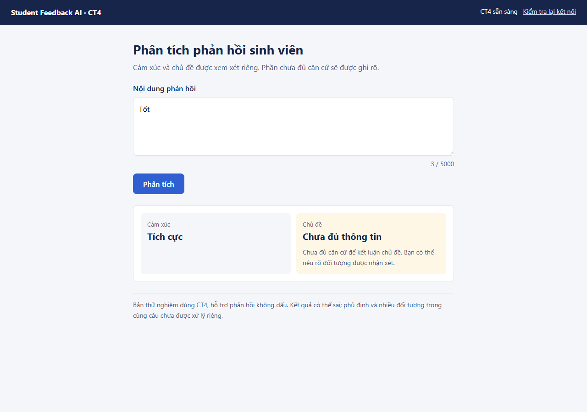

# Demo CT4 — trả kết quả riêng từng phần, 2026-11-01

User đã yêu cầu áp dụng CT4 và xác định cảm xúc/chủ đề riêng. Đây là demo thử local, không nghiệm thu production hoặc đánh giá độc lập mới. Phủ định và nhiều đối tượng chưa xử lý riêng.

## Mở demo

[Bản CT4 mới](http://127.0.0.1:8001/) dùng app demo_v2; [baseline](http://127.0.0.1:8000/) giữ nguyên khi server cũ đang chạy. Chạy từ integration-p0:

```powershell
./.venv/Scripts/python.exe -B -m uvicorn demo_v2.main:app --host 127.0.0.1 --port 8001
```

Không chép đè models/ hay backend/frontend cũ. CT4 pair tải read-only từ `.local-tools/ct4-augmentation/run-1/research-selected/`; hai model này có metadata, checksum và runtime được kiểm. Cấu hình q10 lấy từ CT5 run-1, có kiểm receipt/config/threshold/model hashes. Dữ liệu/model/nguồn vẫn local, license unknown; không publish.

## Hành vi

Mỗi task chỉ trả nhãn khi vector hoàn chỉnh có đặc trưng và gap≥ngưỡng q10 riêng của task. Word rỗng/char có tín hiệu không bị reject riêng vì word. Gap không finite là lỗi; không biến thành nhãn. CT5 helper cũ giữ nguyên, lớp policy mới chặn finite-gap trước khi xuất kết quả.

q10 là lựa chọn demo tạm thời của người triển khai; các known examples đã được xem trước khi chọn cấu hình thử. Không chọn lại threshold, train hay calibrate. Chưa có chính sách production hoặc bằng chứng semantic/OOD mới; không coi SVM margin là xác suất confidence.

Trung tính/Khác chỉ hiển thị khi model thực sự trả nhãn và task được nhận. Thiếu căn cứ dùng status riêng, label=null và “Chưa đủ thông tin”, không ép thành neutral/other.

| Câu thử thực | Cảm xúc | Chủ đề |
| --- | --- | --- |
| Tốt | Tích cực | Chưa đủ thông tin |
| 🙂🙂🙂 | Chưa đủ thông tin | Chưa đủ thông tin |
| Thay giang bai de hieu va rat nhiet tinh. | Tích cực | Giảng viên |
| Thầy giảng bài rõ ràng và phòng học thì nóng. | Tiêu cực | Chưa đủ thông tin |
| Bài giảng không khó hiểu như em nghĩ. | Tiêu cực | Chương trình đào tạo |
| Quán phở đầu ngõ rất ngon. | Tiêu cực | Chương trình đào tạo |

Các câu trên là chẩn đoán đã lộ, không ground truth độc lập. Câu phủ định vẫn có thể bị kết luận tiêu cực với margin cao; câu ngoài miền vẫn có thể được nhận. Gate không chứng minh mô hình hiểu đúng hoặc nhận ra ngoài miền. Không sửa luật riêng cho ví dụ.



## API 2.0 trong app thử nghiệm

`POST /api/v2/predict` nhận raw text strict, tối đa5000 code points, không blank/extra fields hoặc lone surrogate. HTTP200 cho complete/partial/insufficient; mỗi task answered hoặc insufficient_information, label canonical hoặc null. Không xuất nhãn thô bị giữ lại hay confidence/margin. Model thiếu/sai503, inference error500 không trả nửa kết quả, input sai422. GET /api/health báo model=ct4. V1 vẫn chạy ứng dụng cũ, không đổi hợp đồng.

Ví dụ response thật cho “Tốt”:

```json
{
  "contract_version": "2.0",
  "status": "partial",
  "sentiment": {
    "status": "answered",
    "label": "positive",
    "reason": null,
    "message": null
  },
  "topic": {
    "status": "insufficient_information",
    "label": null,
    "reason": "low_margin",
    "message": "Chưa đủ căn cứ để kết luận chủ đề. Bạn có thể nêu rõ đối tượng được nhận xét."
  }
}
```

## Coverage và chất lượng có điều kiện

Bảng dưới cùng 791 policy-audit IDs từ validation đã lộ CT1–CT5; ngưỡng chỉ lấy từ 792 development IDs. Không là final mù. Correct/N không tính từ chối thành đúng.

| Task | Input N | Accepted N | Coverage | Accepted accuracy | Accepted Macro F1 | Correct-and-answered / N |
| --- | ---: | ---: | ---: | ---: | ---: | ---: |
| sentiment | 791 | 692 | 87.4842% | 94.7977% | 81.5630% | 82.9330% |
| topic | 791 | 737 | 93.1732% | 91.1805% | 80.8471% | 84.9558% |

Cả hai task được nhận: 646/791 = 81.6688%; accepted joint accuracy 88.8545%, selective risk 11.1455%, joint correct-and-answered 574/791 = 72.5664%. Khớp CT5 q10 cũ cho pair-accepted; điểm khác biệt giao diện là nay vẫn trả task được nhận khi task kia không đủ căn cứ. Không lấy trung bình Accuracy hai task làm joint.

Trên full validation1583: {'complete': 1293, 'partial': 267, 'insufficient': 23}; xem verification.json để biết metrics tách full/development/audit, confusion matrix/per-class/support. Chưa đánh giá test để chọn policy, chưa có answerability/final được hai người rà; false reject/unsafe accept chưa nghiệm thu.

## Kiểm chứng và bảo toàn

RED module thiếu rồi API GREEN34; RED browser HTTP500 khi frontend chưa có; GREEN63 tests API/browser trên Chrome/Edge, 1 cảnh báo Starlette/httpx đã biết. No-fit verifier chạy với các fit APIs bị cấm, so API/service và metrics cũ trên cùng IDs.

- full-suite-final.txt: 435 passed, 14 warnings in 430.55s (0:07:10)
- pip-check.txt: No broken requirements found.
- frozen-ct5-replay.txt:   "verified": true,

Preservation: 654/654 preexisting hashes khớp; restored=[]. Cả CT1–CT5 và source/model cũ giữ nguyên. Browser outputs mới tại evidence/ct4-partial-demo/browser, refresh baseline giữ riêng, không gán mock làm bằng chứng thật.

Review độc lập và kết luận cuối tại reports/evidence/ct4-partial-demo/review.md; không suy ra đã review chỉ từ report tồn tại. Hai vấn đề readiness/stale result đã có regression RED17 fail→GREEN84 tests; final full suite sau sửa là bằng chứng toàn bộ mới nhất. Không commit/push/merge/Phase6 hoặc dọn worktree.
