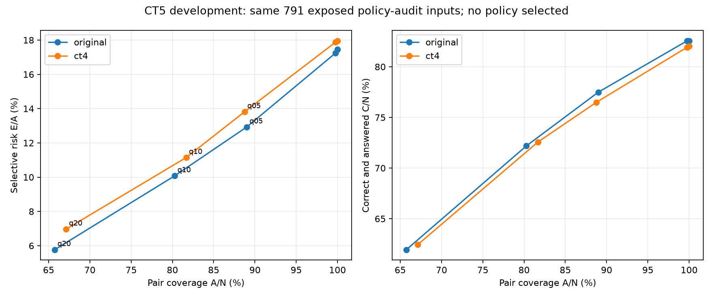

# CT5 mốc A — Selective prediction offline, 2026-11-01

**Trạng thái:** engineering_complete_independent_evaluation_pending. Chưa có policy triển khai; `recommended_policy=null`, `needs_coverage_risk_decision`. Hai model demo và API/UI 1.0 giữ nguyên.

Công cụ chỉ đọc hai cặp frozen: original và CT4 research-selected (sentiment ct3parent_aug100, topic ct3parent_aug25). Không train/calibrate, không thêm dữ liệu hoặc cấu hình ngoài 5 policies đã chốt cho mỗi pair. SVM margin không phải xác suất confidence.

## Dữ liệu và phép đo

Validation 1583 câu chia theo group hash cố định: threshold-development 792, policy-audit 791; group counts {'threshold_development': 792, 'policy_audit': 791}. Cả hai đã lộ từ CT1–CT4, không là final/holdout độc lập mới. Train chỉ đọc để kiểm overlap; runner không đọc test để suy luận hoặc chọn threshold.

group_key=normalize_text(unaccent(text)); SHA256('ct5-v1|42|'+group_key); byte đầu <128 là development. Cùng group luôn cùng phía; không đổi seed/chia lại sau xem điểm. Không có group validation nhiều nhãn trong run này; overlap train/selected augmentation sau bỏ dấu: 6 validation rows. Chi tiết IDs/nhãn tại partition.json; không lọc/relabel, chưa chứng nhận hết near-duplicate.

## Coverage–risk trên cùng policy-audit IDs

N=tổng input, A=nhận cả cặp, C=nhận và cả hai đúng, E=nhận nhưng sai ít nhất một nhãn. Coverage=A/N; accepted accuracy=C/A; selective risk=E/A; correct-and-answered=C/N. Rejected không tính thành đúng. Tất cả 791 audit rows có đủ hai nhãn; mẫu số so sánh giữ nguyên.

| Pair/policy | N | A | C | E | Coverage | Accepted accuracy | Selective risk | C/N | E/N | Rejected correct | Rejected wrong |
| --- | --- | --- | --- | --- | --- | --- | --- | --- | --- | --- | --- |
| original/always_answer | 791 | 791 | 653 | 138 | 100.0000% | 82.5537% | 17.4463% | 82.5537% | 17.4463% | 0 | 0 |
| original/zero_features | 791 | 789 | 653 | 136 | 99.7472% | 82.7630% | 17.2370% | 82.5537% | 17.1934% | 0 | 2 |
| original/zero_plus_margin_q05 | 791 | 704 | 613 | 91 | 89.0013% | 87.0739% | 12.9261% | 77.4968% | 11.5044% | 40 | 47 |
| original/zero_plus_margin_q10 | 791 | 635 | 571 | 64 | 80.2781% | 89.9213% | 10.0787% | 72.1871% | 8.0910% | 82 | 74 |
| original/zero_plus_margin_q20 | 791 | 520 | 490 | 30 | 65.7396% | 94.2308% | 5.7692% | 61.9469% | 3.7927% | 163 | 108 |
| ct4/always_answer | 791 | 791 | 649 | 142 | 100.0000% | 82.0480% | 17.9520% | 82.0480% | 17.9520% | 0 | 0 |
| ct4/zero_features | 791 | 789 | 648 | 141 | 99.7472% | 82.1293% | 17.8707% | 81.9216% | 17.8255% | 1 | 1 |
| ct4/zero_plus_margin_q05 | 791 | 702 | 605 | 97 | 88.7484% | 86.1823% | 13.8177% | 76.4855% | 12.2630% | 44 | 45 |
| ct4/zero_plus_margin_q10 | 791 | 646 | 574 | 72 | 81.6688% | 88.8545% | 11.1455% | 72.5664% | 9.1024% | 75 | 70 |
| ct4/zero_plus_margin_q20 | 791 | 531 | 494 | 37 | 67.1302% | 93.0320% | 6.9680% | 62.4526% | 4.6776% | 155 | 105 |

Original q10: accepted accuracy tăng từ 82,5537% lên 89,9213%, nhưng coverage còn 80,2781% và C/N giảm còn 72,1871%. Q20 tiếp tục giảm risk bằng cách bỏ nhiều input hơn. Không gọi đây là tăng độ chính xác toàn hệ thống. Không chọn policy chỉ vì accepted accuracy cao nhất.



## Model effect khác gating effect

Trên cùng 791 audit IDs, always-answer original đúng 653, CT4 đúng 649: model effect là giảm 4 câu (−0,5057 điểm %). CT4 q10 trả đúng 574/791; chênh CT4 ungated→gated là bỏ 75 câu vốn đúng, không phải classifier sửa nhãn. Mỗi pair giữ nguyên raw predictions qua cả 5 policies.

## Ungated full validation — bảng riêng, không so sai mẫu số

| Pair | N | Sentiment Accuracy | Macro F1 | Topic Accuracy | Macro F1 | Joint C/N |
| --- | --- | --- | --- | --- | --- | --- |
| original | 1583 | 91.4719% | 75.2966% | 87.9975% | 75.4173% | 1296/1583 = 81.8699% |
| ct4 | 1583 | 91.2824% | 79.7398% | 87.8711% | 76.9484% | 1292/1583 = 81.6172% |

Khớp baseline 1296/1583 và CT4 1292/1583 đã lưu. Không dùng bảng 1583 để so trực tiếp gate trên 791 như cùng mẫu số.

## Ngưỡng và diagnostics

Gap=top1_score−top2_score theo classes_ thật. Ngưỡng quantile method=linear lấy riêng mỗi task/model trên rows nonzero của development; không dùng audit/known/stress/test. Nhận task khi vector hoàn chỉnh nonzero và gap≥threshold. Nhận pair khi cả hai task nhận. Word rỗng nhưng char còn tín hiệu không bị reject chỉ vì word. Không có ngưỡng chung cho min hai margin khác thang đo.

| Pair/policy | Sentiment threshold | Topic threshold |
| --- | --- | --- |
| original/zero_plus_margin_q05 | 0.3718962909479934 | 0.1835545178243731 |
| original/zero_plus_margin_q10 | 0.6289172222920781 | 0.3870403645232766 |
| original/zero_plus_margin_q20 | 1.0785705238290233 | 0.6843693740148378 |
| ct4/zero_plus_margin_q05 | 0.36486744863261655 | 0.15107577706185693 |
| ct4/zero_plus_margin_q10 | 0.6889687043718054 | 0.294988454408041 |
| ct4/zero_plus_margin_q20 | 1.2432480583889007 | 0.6721019995085211 |

Luôn lưu nnz toàn vector, nnz từng nhánh, scores/classes, gap, threshold, raw_prediction, accepted từng task/pair và reason. Pair reject thì labels_for_display=null cho cả hai; không trả nửa kết quả. Model lỗi/score sai shape/nonfinite/predict không khớp class columns là error, không ngụy trang thành abstention. Zero-vector và low-margin chỉ là lý do kỹ thuật, không chứng minh ngoài miền.

## Per-task và pair-accepted audit metrics

| Pair/policy | Audit rejection reasons (có thể trùng trên cùng input) |
| --- | --- |
| original/always_answer | {} |
| original/zero_features | {"zero_features_sentiment": 2, "zero_features_topic": 2} |
| original/zero_plus_margin_q05 | {"low_margin_sentiment": 64, "low_margin_topic": 31, "zero_features_sentiment": 2, "zero_features_topic": 2} |
| original/zero_plus_margin_q10 | {"low_margin_sentiment": 104, "low_margin_topic": 69, "zero_features_sentiment": 2, "zero_features_topic": 2} |
| original/zero_plus_margin_q20 | {"low_margin_sentiment": 180, "low_margin_topic": 130, "zero_features_sentiment": 2, "zero_features_topic": 2} |
| ct4/always_answer | {} |
| ct4/zero_features | {"zero_features_topic": 2} |
| ct4/zero_plus_margin_q05 | {"low_margin_sentiment": 56, "low_margin_topic": 35, "zero_features_topic": 2} |
| ct4/zero_plus_margin_q10 | {"low_margin_sentiment": 99, "low_margin_topic": 54, "zero_features_topic": 2} |
| ct4/zero_plus_margin_q20 | {"low_margin_sentiment": 171, "low_margin_topic": 129, "zero_features_topic": 2} |

| Pair/policy/task | Task coverage | Task accepted labeled N | Task Accuracy | Task Macro F1 | Pair accepted labeled N | Pair Accuracy | Pair Macro F1 |
| --- | --- | --- | --- | --- | --- | --- | --- |
| original/always_answer/sentiment | 100.0000% | 791 | 90.6448% | 74.5476% | 791 | 90.6448% | 74.5476% |
| original/always_answer/topic | 100.0000% | 791 | 88.7484% | 78.2419% | 791 | 88.7484% | 78.2419% |
| original/zero_features/sentiment | 99.7472% | 789 | 90.8745% | 74.9018% | 789 | 90.8745% | 74.9018% |
| original/zero_features/topic | 99.7472% | 789 | 88.9734% | 78.6299% | 789 | 88.9734% | 78.6299% |
| original/zero_plus_margin_q05/sentiment | 91.9090% | 727 | 93.5351% | 74.7307% | 704 | 93.6080% | 72.2352% |
| original/zero_plus_margin_q05/topic | 96.0809% | 760 | 90.7895% | 80.0017% | 704 | 91.4773% | 80.1135% |
| original/zero_plus_margin_q10/sentiment | 86.8521% | 687 | 95.1965% | 76.5530% | 635 | 95.2756% | 74.1415% |
| original/zero_plus_margin_q10/topic | 91.2769% | 722 | 91.5512% | 80.4775% | 635 | 92.9134% | 81.9955% |
| original/zero_plus_margin_q20/sentiment | 77.2440% | 611 | 97.5450% | 78.8207% | 520 | 98.0769% | 83.7872% |
| original/zero_plus_margin_q20/topic | 83.5651% | 661 | 93.4947% | 79.4186% | 520 | 95.5769% | 83.0723% |
| ct4/always_answer/sentiment | 100.0000% | 791 | 90.2655% | 79.1386% | 791 | 90.2655% | 79.1386% |
| ct4/always_answer/topic | 100.0000% | 791 | 89.0013% | 79.3265% | 791 | 89.0013% | 79.3265% |
| ct4/zero_features/sentiment | 100.0000% | 791 | 90.2655% | 79.1386% | 789 | 90.3676% | 78.9832% |
| ct4/zero_features/topic | 99.7472% | 789 | 88.9734% | 78.7310% | 789 | 88.9734% | 78.7310% |
| ct4/zero_plus_margin_q05/sentiment | 92.9204% | 735 | 92.7891% | 80.8046% | 702 | 93.0199% | 81.1405% |
| ct4/zero_plus_margin_q05/topic | 95.3224% | 754 | 90.4509% | 80.2574% | 702 | 90.8832% | 78.6230% |
| ct4/zero_plus_margin_q10/sentiment | 87.4842% | 692 | 94.7977% | 81.5630% | 646 | 95.0464% | 79.0311% |
| ct4/zero_plus_margin_q10/topic | 93.1732% | 737 | 91.1805% | 80.8471% | 646 | 92.1053% | 79.4570% |
| ct4/zero_plus_margin_q20/sentiment | 78.3818% | 620 | 96.2903% | 82.8426% | 531 | 96.9868% | 82.7203% |
| ct4/zero_plus_margin_q20/topic | 83.6915% | 662 | 93.6556% | 83.3185% | 531 | 95.1036% | 84.0116% |

Per-class dưới đây trên **pair-accepted subset**, support thay đổi theo policy; không so như một tập cố định. JSON metrics.json có đầy đủ cả task-accepted và pair-accepted P/R/F1/support, confusion matrix và canonical label order, kể cả lớp support=0.

| Pair/policy/task/class | Precision | Recall | F1 | Support |
| --- | --- | --- | --- | --- |
| original/always_answer/sentiment/negative | 90.0277% | 93.1232% | 91.5493% | 349 |
| original/always_answer/sentiment/neutral | 68.7500% | 26.8293% | 38.5965% | 41 |
| original/always_answer/sentiment/positive | 92.0290% | 95.0125% | 93.4969% | 401 |
| original/always_answer/topic/lecturer | 92.9674% | 94.9212% | 93.9341% | 571 |
| original/always_answer/topic/curriculum | 72.6667% | 81.3433% | 76.7606% | 134 |
| original/always_answer/topic/facility | 91.6667% | 94.2857% | 92.9577% | 35 |
| original/always_answer/topic/other | 81.8182% | 35.2941% | 49.3151% | 51 |
| original/zero_features/sentiment/negative | 90.5292% | 93.1232% | 91.8079% | 349 |
| original/zero_features/sentiment/neutral | 68.7500% | 27.5000% | 39.2857% | 40 |
| original/zero_features/sentiment/positive | 92.0290% | 95.2500% | 93.6118% | 400 |
| original/zero_features/topic/lecturer | 93.2874% | 94.9212% | 94.0972% | 571 |
| original/zero_features/topic/curriculum | 72.6667% | 81.3433% | 76.7606% | 134 |
| original/zero_features/topic/facility | 91.6667% | 94.2857% | 92.9577% | 35 |
| original/zero_features/topic/other | 81.8182% | 36.7347% | 50.7042% | 49 |
| original/zero_plus_margin_q05/sentiment/negative | 93.2099% | 95.5696% | 94.3750% | 316 |
| original/zero_plus_margin_q05/sentiment/neutral | 57.1429% | 17.3913% | 26.6667% | 23 |
| original/zero_plus_margin_q05/sentiment/positive | 94.6381% | 96.7123% | 95.6640% | 365 |
| original/zero_plus_margin_q05/topic/lecturer | 94.8960% | 96.1686% | 95.5281% | 522 |
| original/zero_plus_margin_q05/topic/curriculum | 77.3438% | 85.3448% | 81.1475% | 116 |
| original/zero_plus_margin_q05/topic/facility | 96.9697% | 96.9697% | 96.9697% | 33 |
| original/zero_plus_margin_q05/topic/other | 78.5714% | 33.3333% | 46.8085% | 33 |
| original/zero_plus_margin_q10/sentiment/negative | 93.5943% | 97.0480% | 95.2899% | 271 |
| original/zero_plus_margin_q10/sentiment/neutral | 60.0000% | 20.0000% | 30.0000% | 15 |
| original/zero_plus_margin_q10/sentiment/positive | 97.1347% | 97.1347% | 97.1347% | 349 |
| original/zero_plus_margin_q10/topic/lecturer | 95.4918% | 96.8815% | 96.1816% | 481 |
| original/zero_plus_margin_q10/topic/curriculum | 78.8991% | 88.6598% | 83.4951% | 97 |
| original/zero_plus_margin_q10/topic/facility | 100.0000% | 96.6667% | 98.3051% | 30 |
| original/zero_plus_margin_q10/topic/other | 100.0000% | 33.3333% | 50.0000% | 27 |
| original/zero_plus_margin_q20/sentiment/negative | 96.5854% | 99.0000% | 97.7778% | 200 |
| original/zero_plus_margin_q20/sentiment/neutral | 100.0000% | 37.5000% | 54.5455% | 8 |
| original/zero_plus_margin_q20/sentiment/positive | 99.0385% | 99.0385% | 99.0385% | 312 |
| original/zero_plus_margin_q20/topic/lecturer | 97.4057% | 97.8673% | 97.6359% | 422 |
| original/zero_plus_margin_q20/topic/curriculum | 82.0896% | 91.6667% | 86.6142% | 60 |
| original/zero_plus_margin_q20/topic/facility | 100.0000% | 96.1538% | 98.0392% | 26 |
| original/zero_plus_margin_q20/topic/other | 100.0000% | 33.3333% | 50.0000% | 12 |
| ct4/always_answer/sentiment/negative | 91.6427% | 91.1175% | 91.3793% | 349 |
| ct4/always_answer/sentiment/neutral | 63.3333% | 46.3415% | 53.5211% | 41 |
| ct4/always_answer/sentiment/positive | 91.0628% | 94.0150% | 92.5153% | 401 |
| ct4/always_answer/topic/lecturer | 94.0559% | 94.2207% | 94.1382% | 571 |
| ct4/always_answer/topic/curriculum | 74.4966% | 82.8358% | 78.4452% | 134 |
| ct4/always_answer/topic/facility | 91.6667% | 94.2857% | 92.9577% | 35 |
| ct4/always_answer/topic/other | 64.7059% | 43.1373% | 51.7647% | 51 |
| ct4/zero_features/sentiment/negative | 91.6427% | 91.1175% | 91.3793% | 349 |
| ct4/zero_features/sentiment/neutral | 64.2857% | 45.0000% | 52.9412% | 40 |
| ct4/zero_features/sentiment/positive | 91.0628% | 94.2500% | 92.6290% | 400 |
| ct4/zero_features/topic/lecturer | 94.0559% | 94.2207% | 94.1382% | 571 |
| ct4/zero_features/topic/curriculum | 74.4966% | 82.8358% | 78.4452% | 134 |
| ct4/zero_features/topic/facility | 91.6667% | 94.2857% | 92.9577% | 35 |
| ct4/zero_features/topic/other | 62.5000% | 40.8163% | 49.3827% | 49 |
| ct4/zero_plus_margin_q05/sentiment/negative | 92.8105% | 93.7294% | 93.2677% | 303 |
| ct4/zero_plus_margin_q05/sentiment/neutral | 71.4286% | 45.4545% | 55.5556% | 22 |
| ct4/zero_plus_margin_q05/sentiment/positive | 93.9791% | 95.2255% | 94.5982% | 377 |
| ct4/zero_plus_margin_q05/topic/lecturer | 95.2199% | 95.4023% | 95.3110% | 522 |
| ct4/zero_plus_margin_q05/topic/curriculum | 75.1938% | 85.8407% | 80.1653% | 113 |
| ct4/zero_plus_margin_q05/topic/facility | 91.4286% | 96.9697% | 94.1176% | 33 |
| ct4/zero_plus_margin_q05/topic/other | 73.3333% | 32.3529% | 44.8980% | 34 |
| ct4/zero_plus_margin_q10/sentiment/negative | 93.9502% | 96.3504% | 95.1351% | 274 |
| ct4/zero_plus_margin_q10/sentiment/neutral | 62.5000% | 35.7143% | 45.4545% | 14 |
| ct4/zero_plus_margin_q10/sentiment/positive | 96.6387% | 96.3687% | 96.5035% | 358 |
| ct4/zero_plus_margin_q10/topic/lecturer | 95.8932% | 95.6967% | 95.7949% | 488 |
| ct4/zero_plus_margin_q10/topic/curriculum | 78.2609% | 87.3786% | 82.5688% | 103 |
| ct4/zero_plus_margin_q10/topic/facility | 90.9091% | 96.7742% | 93.7500% | 31 |
| ct4/zero_plus_margin_q10/topic/other | 72.7273% | 33.3333% | 45.7143% | 24 |
| ct4/zero_plus_margin_q20/sentiment/negative | 94.8357% | 98.0583% | 96.4200% | 206 |
| ct4/zero_plus_margin_q20/sentiment/neutral | 80.0000% | 40.0000% | 53.3333% | 10 |
| ct4/zero_plus_margin_q20/sentiment/positive | 98.7220% | 98.0952% | 98.4076% | 315 |
| ct4/zero_plus_margin_q20/topic/lecturer | 97.4178% | 97.1897% | 97.3036% | 427 |
| ct4/zero_plus_margin_q20/topic/curriculum | 80.5195% | 92.5373% | 86.1111% | 67 |
| ct4/zero_plus_margin_q20/topic/facility | 100.0000% | 100.0000% | 100.0000% | 23 |
| ct4/zero_plus_margin_q20/topic/other | 100.0000% | 35.7143% | 52.6316% | 14 |

## Development — chỉ mô tả, không gọi là audit/final

| Pair/policy | N | Coverage | Accepted accuracy | Risk | C/N |
| --- | --- | --- | --- | --- | --- |
| original/always_answer | 792 | 100.0000% | 81.1869% | 18.8131% | 81.1869% |
| original/zero_features | 792 | 100.0000% | 81.1869% | 18.8131% | 81.1869% |
| original/zero_plus_margin_q05 | 792 | 90.2778% | 85.4545% | 14.5455% | 77.1465% |
| original/zero_plus_margin_q10 | 792 | 81.3131% | 89.4410% | 10.5590% | 72.7273% |
| original/zero_plus_margin_q20 | 792 | 66.2879% | 91.8095% | 8.1905% | 60.8586% |
| ct4/always_answer | 792 | 100.0000% | 81.1869% | 18.8131% | 81.1869% |
| ct4/zero_features | 792 | 100.0000% | 81.1869% | 18.8131% | 81.1869% |
| ct4/zero_plus_margin_q05 | 792 | 90.5303% | 85.3556% | 14.6444% | 77.2727% |
| ct4/zero_plus_margin_q10 | 792 | 81.6919% | 88.5626% | 11.4374% | 72.3485% |
| ct4/zero_plus_margin_q20 | 792 | 66.0354% | 91.7782% | 8.2218% | 60.6061% |

## Known và synthetic stress — tách riêng

Known: 39 câu đã lộ, kỳ vọng assistant_proposed chưa human-reviewed. Joint chỉ chấm 25 câu có đủ hai nhãn; sentiment 30, topic 29. Coverage vẫn tính trên 39 input. C/N dưới đây dùng N có đủ hai nhãn, không lấy 39 làm mẫu số correctness. Null không tự ép thành neutral/other.

Stress: 1583 validation sources bỏ dấu, nhãn kế thừa weak supervision; sáu overlap sau bỏ dấu với train và validation đã lộ làm giới hạn tính độc lập. Không chọn ngưỡng bằng stress/known.

| Dataset/pair/policy | Input N | Joint labeled N | Coverage | Accepted labeled accuracy | Risk | C/N labeled |
| --- | --- | --- | --- | --- | --- | --- |
| known/original/always_answer | 39 | 25 | 100.0000% | 72.0000% | 28.0000% | 72.0000% |
| known/original/zero_features | 39 | 25 | 92.3077% | 72.0000% | 28.0000% | 72.0000% |
| known/original/zero_plus_margin_q05 | 39 | 25 | 82.0513% | 73.9130% | 26.0870% | 68.0000% |
| known/original/zero_plus_margin_q10 | 39 | 25 | 53.8462% | 88.2353% | 11.7647% | 60.0000% |
| known/original/zero_plus_margin_q20 | 39 | 25 | 43.5897% | 92.8571% | 7.1429% | 52.0000% |
| known/ct4/always_answer | 39 | 25 | 100.0000% | 88.0000% | 12.0000% | 88.0000% |
| known/ct4/zero_features | 39 | 25 | 92.3077% | 88.0000% | 12.0000% | 88.0000% |
| known/ct4/zero_plus_margin_q05 | 39 | 25 | 76.9231% | 91.3043% | 8.6957% | 84.0000% |
| known/ct4/zero_plus_margin_q10 | 39 | 25 | 66.6667% | 90.0000% | 10.0000% | 72.0000% |
| known/ct4/zero_plus_margin_q20 | 39 | 25 | 43.5897% | 93.3333% | 6.6667% | 56.0000% |
| stress_unaccented_validation/original/always_answer | 1583 | 1583 | 100.0000% | 32.4068% | 67.5932% | 32.4068% |
| stress_unaccented_validation/original/zero_features | 1583 | 1583 | 97.3468% | 32.5762% | 67.4238% | 31.7119% |
| stress_unaccented_validation/original/zero_plus_margin_q05 | 1583 | 1583 | 42.5774% | 38.5757% | 61.4243% | 16.4245% |
| stress_unaccented_validation/original/zero_plus_margin_q10 | 1583 | 1583 | 19.3304% | 51.3072% | 48.6928% | 9.9179% |
| stress_unaccented_validation/original/zero_plus_margin_q20 | 1583 | 1583 | 4.2956% | 58.8235% | 41.1765% | 2.5268% |
| stress_unaccented_validation/ct4/always_answer | 1583 | 1583 | 100.0000% | 78.3955% | 21.6045% | 78.3955% |
| stress_unaccented_validation/ct4/zero_features | 1583 | 1583 | 99.9368% | 78.4450% | 21.5550% | 78.3955% |
| stress_unaccented_validation/ct4/zero_plus_margin_q05 | 1583 | 1583 | 89.1977% | 82.5779% | 17.4221% | 73.6576% |
| stress_unaccented_validation/ct4/zero_plus_margin_q10 | 1583 | 1583 | 80.1011% | 86.3565% | 13.6435% | 69.1725% |
| stress_unaccented_validation/ct4/zero_plus_margin_q20 | 1583 | 1583 | 63.2344% | 90.7093% | 9.2907% | 57.3594% |

Known groups giữ riêng trong metrics.json; ví dụ các ca không có ground truth vẫn được báo coverage và đầu ra, không coi là phép đo OOD accuracy. Với CT4 q10, ca known thuộc nhóm out_of_domain vẫn được nhận, 1/3 ambiguous_topic được nhận và ca conflicting_emoji được nhận. Đây là nhóm assistant-proposed, không là human-reviewed answerability; minh họa gate không bảo đảm hiểu/ngăn ngoài miền. Không thêm blacklist hoặc đổi threshold sau xem chúng.

| Known group/pair/policy | Input N | Joint labeled N | Pair coverage | Correct answered |
| --- | --- | --- | --- | --- |
| accented_control/original/always_answer | 1 | 1 | 100.0000% | 1 |
| ambiguous_topic/original/always_answer | 3 | 0 | 100.0000% | 0 |
| clear/original/always_answer | 9 | 9 | 100.0000% | 9 |
| conflicting_emoji/original/always_answer | 1 | 0 | 100.0000% | 0 |
| emoji/original/always_answer | 1 | 1 | 100.0000% | 0 |
| emoji_control/original/always_answer | 1 | 1 | 100.0000% | 0 |
| emoji_only/original/always_answer | 2 | 0 | 100.0000% | 0 |
| informal/original/always_answer | 1 | 1 | 100.0000% | 1 |
| mixed_sentiment/original/always_answer | 1 | 0 | 100.0000% | 0 |
| mixed_topic/original/always_answer | 1 | 0 | 100.0000% | 0 |
| negation/original/always_answer | 2 | 1 | 100.0000% | 0 |
| negation_control/original/always_answer | 2 | 2 | 100.0000% | 2 |
| neutral/original/always_answer | 4 | 3 | 100.0000% | 0 |
| neutral_other/original/always_answer | 4 | 4 | 100.0000% | 4 |
| nonsense/original/always_answer | 1 | 0 | 100.0000% | 0 |
| out_of_domain/original/always_answer | 1 | 0 | 100.0000% | 0 |
| sarcasm/original/always_answer | 1 | 1 | 100.0000% | 1 |
| short/original/always_answer | 1 | 0 | 100.0000% | 0 |
| suggestion/original/always_answer | 1 | 0 | 100.0000% | 0 |
| unaccented/original/always_answer | 1 | 1 | 100.0000% | 0 |
| accented_control/original/zero_features | 1 | 1 | 100.0000% | 1 |
| ambiguous_topic/original/zero_features | 3 | 0 | 100.0000% | 0 |
| clear/original/zero_features | 9 | 9 | 100.0000% | 9 |
| conflicting_emoji/original/zero_features | 1 | 0 | 100.0000% | 0 |
| emoji/original/zero_features | 1 | 1 | 100.0000% | 0 |
| emoji_control/original/zero_features | 1 | 1 | 100.0000% | 0 |
| emoji_only/original/zero_features | 2 | 0 | 0.0000% | 0 |
| informal/original/zero_features | 1 | 1 | 100.0000% | 1 |
| mixed_sentiment/original/zero_features | 1 | 0 | 100.0000% | 0 |
| mixed_topic/original/zero_features | 1 | 0 | 100.0000% | 0 |
| negation/original/zero_features | 2 | 1 | 100.0000% | 0 |
| negation_control/original/zero_features | 2 | 2 | 100.0000% | 2 |
| neutral/original/zero_features | 4 | 3 | 100.0000% | 0 |
| neutral_other/original/zero_features | 4 | 4 | 100.0000% | 4 |
| nonsense/original/zero_features | 1 | 0 | 0.0000% | 0 |
| out_of_domain/original/zero_features | 1 | 0 | 100.0000% | 0 |
| sarcasm/original/zero_features | 1 | 1 | 100.0000% | 1 |
| short/original/zero_features | 1 | 0 | 100.0000% | 0 |
| suggestion/original/zero_features | 1 | 0 | 100.0000% | 0 |
| unaccented/original/zero_features | 1 | 1 | 100.0000% | 0 |
| accented_control/original/zero_plus_margin_q05 | 1 | 1 | 100.0000% | 1 |
| ambiguous_topic/original/zero_plus_margin_q05 | 3 | 0 | 66.6667% | 0 |
| clear/original/zero_plus_margin_q05 | 9 | 9 | 88.8889% | 8 |
| conflicting_emoji/original/zero_plus_margin_q05 | 1 | 0 | 100.0000% | 0 |
| emoji/original/zero_plus_margin_q05 | 1 | 1 | 100.0000% | 0 |
| emoji_control/original/zero_plus_margin_q05 | 1 | 1 | 100.0000% | 0 |
| emoji_only/original/zero_plus_margin_q05 | 2 | 0 | 0.0000% | 0 |
| informal/original/zero_plus_margin_q05 | 1 | 1 | 100.0000% | 1 |
| mixed_sentiment/original/zero_plus_margin_q05 | 1 | 0 | 100.0000% | 0 |
| mixed_topic/original/zero_plus_margin_q05 | 1 | 0 | 100.0000% | 0 |
| negation/original/zero_plus_margin_q05 | 2 | 1 | 100.0000% | 0 |
| negation_control/original/zero_plus_margin_q05 | 2 | 2 | 100.0000% | 2 |
| neutral/original/zero_plus_margin_q05 | 4 | 3 | 100.0000% | 0 |
| neutral_other/original/zero_plus_margin_q05 | 4 | 4 | 100.0000% | 4 |
| nonsense/original/zero_plus_margin_q05 | 1 | 0 | 0.0000% | 0 |
| out_of_domain/original/zero_plus_margin_q05 | 1 | 0 | 0.0000% | 0 |
| sarcasm/original/zero_plus_margin_q05 | 1 | 1 | 100.0000% | 1 |
| short/original/zero_plus_margin_q05 | 1 | 0 | 100.0000% | 0 |
| suggestion/original/zero_plus_margin_q05 | 1 | 0 | 100.0000% | 0 |
| unaccented/original/zero_plus_margin_q05 | 1 | 1 | 0.0000% | 0 |
| accented_control/original/zero_plus_margin_q10 | 1 | 1 | 100.0000% | 1 |
| ambiguous_topic/original/zero_plus_margin_q10 | 3 | 0 | 33.3333% | 0 |
| clear/original/zero_plus_margin_q10 | 9 | 9 | 77.7778% | 7 |
| conflicting_emoji/original/zero_plus_margin_q10 | 1 | 0 | 0.0000% | 0 |
| emoji/original/zero_plus_margin_q10 | 1 | 1 | 0.0000% | 0 |
| emoji_control/original/zero_plus_margin_q10 | 1 | 1 | 0.0000% | 0 |
| emoji_only/original/zero_plus_margin_q10 | 2 | 0 | 0.0000% | 0 |
| informal/original/zero_plus_margin_q10 | 1 | 1 | 100.0000% | 1 |
| mixed_sentiment/original/zero_plus_margin_q10 | 1 | 0 | 100.0000% | 0 |
| mixed_topic/original/zero_plus_margin_q10 | 1 | 0 | 0.0000% | 0 |
| negation/original/zero_plus_margin_q10 | 2 | 1 | 100.0000% | 0 |
| negation_control/original/zero_plus_margin_q10 | 2 | 2 | 100.0000% | 2 |
| neutral/original/zero_plus_margin_q10 | 4 | 3 | 25.0000% | 0 |
| neutral_other/original/zero_plus_margin_q10 | 4 | 4 | 100.0000% | 4 |
| nonsense/original/zero_plus_margin_q10 | 1 | 0 | 0.0000% | 0 |
| out_of_domain/original/zero_plus_margin_q10 | 1 | 0 | 0.0000% | 0 |
| sarcasm/original/zero_plus_margin_q10 | 1 | 1 | 0.0000% | 0 |
| short/original/zero_plus_margin_q10 | 1 | 0 | 0.0000% | 0 |
| suggestion/original/zero_plus_margin_q10 | 1 | 0 | 100.0000% | 0 |
| unaccented/original/zero_plus_margin_q10 | 1 | 1 | 0.0000% | 0 |
| accented_control/original/zero_plus_margin_q20 | 1 | 1 | 100.0000% | 1 |
| ambiguous_topic/original/zero_plus_margin_q20 | 3 | 0 | 0.0000% | 0 |
| clear/original/zero_plus_margin_q20 | 9 | 9 | 66.6667% | 6 |
| conflicting_emoji/original/zero_plus_margin_q20 | 1 | 0 | 0.0000% | 0 |
| emoji/original/zero_plus_margin_q20 | 1 | 1 | 0.0000% | 0 |
| emoji_control/original/zero_plus_margin_q20 | 1 | 1 | 0.0000% | 0 |
| emoji_only/original/zero_plus_margin_q20 | 2 | 0 | 0.0000% | 0 |
| informal/original/zero_plus_margin_q20 | 1 | 1 | 100.0000% | 1 |
| mixed_sentiment/original/zero_plus_margin_q20 | 1 | 0 | 100.0000% | 0 |
| mixed_topic/original/zero_plus_margin_q20 | 1 | 0 | 0.0000% | 0 |
| negation/original/zero_plus_margin_q20 | 2 | 1 | 50.0000% | 0 |
| negation_control/original/zero_plus_margin_q20 | 2 | 2 | 100.0000% | 2 |
| neutral/original/zero_plus_margin_q20 | 4 | 3 | 25.0000% | 0 |
| neutral_other/original/zero_plus_margin_q20 | 4 | 4 | 75.0000% | 3 |
| nonsense/original/zero_plus_margin_q20 | 1 | 0 | 0.0000% | 0 |
| out_of_domain/original/zero_plus_margin_q20 | 1 | 0 | 0.0000% | 0 |
| sarcasm/original/zero_plus_margin_q20 | 1 | 1 | 0.0000% | 0 |
| short/original/zero_plus_margin_q20 | 1 | 0 | 0.0000% | 0 |
| suggestion/original/zero_plus_margin_q20 | 1 | 0 | 100.0000% | 0 |
| unaccented/original/zero_plus_margin_q20 | 1 | 1 | 0.0000% | 0 |
| accented_control/ct4/always_answer | 1 | 1 | 100.0000% | 1 |
| ambiguous_topic/ct4/always_answer | 3 | 0 | 100.0000% | 0 |
| clear/ct4/always_answer | 9 | 9 | 100.0000% | 8 |
| conflicting_emoji/ct4/always_answer | 1 | 0 | 100.0000% | 0 |
| emoji/ct4/always_answer | 1 | 1 | 100.0000% | 1 |
| emoji_control/ct4/always_answer | 1 | 1 | 100.0000% | 1 |
| emoji_only/ct4/always_answer | 2 | 0 | 100.0000% | 0 |
| informal/ct4/always_answer | 1 | 1 | 100.0000% | 1 |
| mixed_sentiment/ct4/always_answer | 1 | 0 | 100.0000% | 0 |
| mixed_topic/ct4/always_answer | 1 | 0 | 100.0000% | 0 |
| negation/ct4/always_answer | 2 | 1 | 100.0000% | 1 |
| negation_control/ct4/always_answer | 2 | 2 | 100.0000% | 2 |
| neutral/ct4/always_answer | 4 | 3 | 100.0000% | 1 |
| neutral_other/ct4/always_answer | 4 | 4 | 100.0000% | 4 |
| nonsense/ct4/always_answer | 1 | 0 | 100.0000% | 0 |
| out_of_domain/ct4/always_answer | 1 | 0 | 100.0000% | 0 |
| sarcasm/ct4/always_answer | 1 | 1 | 100.0000% | 1 |
| short/ct4/always_answer | 1 | 0 | 100.0000% | 0 |
| suggestion/ct4/always_answer | 1 | 0 | 100.0000% | 0 |
| unaccented/ct4/always_answer | 1 | 1 | 100.0000% | 1 |
| accented_control/ct4/zero_features | 1 | 1 | 100.0000% | 1 |
| ambiguous_topic/ct4/zero_features | 3 | 0 | 100.0000% | 0 |
| clear/ct4/zero_features | 9 | 9 | 100.0000% | 8 |
| conflicting_emoji/ct4/zero_features | 1 | 0 | 100.0000% | 0 |
| emoji/ct4/zero_features | 1 | 1 | 100.0000% | 1 |
| emoji_control/ct4/zero_features | 1 | 1 | 100.0000% | 1 |
| emoji_only/ct4/zero_features | 2 | 0 | 0.0000% | 0 |
| informal/ct4/zero_features | 1 | 1 | 100.0000% | 1 |
| mixed_sentiment/ct4/zero_features | 1 | 0 | 100.0000% | 0 |
| mixed_topic/ct4/zero_features | 1 | 0 | 100.0000% | 0 |
| negation/ct4/zero_features | 2 | 1 | 100.0000% | 1 |
| negation_control/ct4/zero_features | 2 | 2 | 100.0000% | 2 |
| neutral/ct4/zero_features | 4 | 3 | 100.0000% | 1 |
| neutral_other/ct4/zero_features | 4 | 4 | 100.0000% | 4 |
| nonsense/ct4/zero_features | 1 | 0 | 0.0000% | 0 |
| out_of_domain/ct4/zero_features | 1 | 0 | 100.0000% | 0 |
| sarcasm/ct4/zero_features | 1 | 1 | 100.0000% | 1 |
| short/ct4/zero_features | 1 | 0 | 100.0000% | 0 |
| suggestion/ct4/zero_features | 1 | 0 | 100.0000% | 0 |
| unaccented/ct4/zero_features | 1 | 1 | 100.0000% | 1 |
| accented_control/ct4/zero_plus_margin_q05 | 1 | 1 | 100.0000% | 1 |
| ambiguous_topic/ct4/zero_plus_margin_q05 | 3 | 0 | 33.3333% | 0 |
| clear/ct4/zero_plus_margin_q05 | 9 | 9 | 88.8889% | 8 |
| conflicting_emoji/ct4/zero_plus_margin_q05 | 1 | 0 | 100.0000% | 0 |
| emoji/ct4/zero_plus_margin_q05 | 1 | 1 | 100.0000% | 1 |
| emoji_control/ct4/zero_plus_margin_q05 | 1 | 1 | 100.0000% | 1 |
| emoji_only/ct4/zero_plus_margin_q05 | 2 | 0 | 0.0000% | 0 |
| informal/ct4/zero_plus_margin_q05 | 1 | 1 | 100.0000% | 1 |
| mixed_sentiment/ct4/zero_plus_margin_q05 | 1 | 0 | 100.0000% | 0 |
| mixed_topic/ct4/zero_plus_margin_q05 | 1 | 0 | 100.0000% | 0 |
| negation/ct4/zero_plus_margin_q05 | 2 | 1 | 50.0000% | 0 |
| negation_control/ct4/zero_plus_margin_q05 | 2 | 2 | 100.0000% | 2 |
| neutral/ct4/zero_plus_margin_q05 | 4 | 3 | 75.0000% | 1 |
| neutral_other/ct4/zero_plus_margin_q05 | 4 | 4 | 100.0000% | 4 |
| nonsense/ct4/zero_plus_margin_q05 | 1 | 0 | 0.0000% | 0 |
| out_of_domain/ct4/zero_plus_margin_q05 | 1 | 0 | 100.0000% | 0 |
| sarcasm/ct4/zero_plus_margin_q05 | 1 | 1 | 100.0000% | 1 |
| short/ct4/zero_plus_margin_q05 | 1 | 0 | 0.0000% | 0 |
| suggestion/ct4/zero_plus_margin_q05 | 1 | 0 | 100.0000% | 0 |
| unaccented/ct4/zero_plus_margin_q05 | 1 | 1 | 100.0000% | 1 |
| accented_control/ct4/zero_plus_margin_q10 | 1 | 1 | 100.0000% | 1 |
| ambiguous_topic/ct4/zero_plus_margin_q10 | 3 | 0 | 33.3333% | 0 |
| clear/ct4/zero_plus_margin_q10 | 9 | 9 | 77.7778% | 7 |
| conflicting_emoji/ct4/zero_plus_margin_q10 | 1 | 0 | 100.0000% | 0 |
| emoji/ct4/zero_plus_margin_q10 | 1 | 1 | 100.0000% | 1 |
| emoji_control/ct4/zero_plus_margin_q10 | 1 | 1 | 100.0000% | 1 |
| emoji_only/ct4/zero_plus_margin_q10 | 2 | 0 | 0.0000% | 0 |
| informal/ct4/zero_plus_margin_q10 | 1 | 1 | 100.0000% | 1 |
| mixed_sentiment/ct4/zero_plus_margin_q10 | 1 | 0 | 100.0000% | 0 |
| mixed_topic/ct4/zero_plus_margin_q10 | 1 | 0 | 0.0000% | 0 |
| negation/ct4/zero_plus_margin_q10 | 2 | 1 | 50.0000% | 0 |
| negation_control/ct4/zero_plus_margin_q10 | 2 | 2 | 100.0000% | 2 |
| neutral/ct4/zero_plus_margin_q10 | 4 | 3 | 50.0000% | 0 |
| neutral_other/ct4/zero_plus_margin_q10 | 4 | 4 | 75.0000% | 3 |
| nonsense/ct4/zero_plus_margin_q10 | 1 | 0 | 0.0000% | 0 |
| out_of_domain/ct4/zero_plus_margin_q10 | 1 | 0 | 100.0000% | 0 |
| sarcasm/ct4/zero_plus_margin_q10 | 1 | 1 | 100.0000% | 1 |
| short/ct4/zero_plus_margin_q10 | 1 | 0 | 0.0000% | 0 |
| suggestion/ct4/zero_plus_margin_q10 | 1 | 0 | 100.0000% | 0 |
| unaccented/ct4/zero_plus_margin_q10 | 1 | 1 | 100.0000% | 1 |
| accented_control/ct4/zero_plus_margin_q20 | 1 | 1 | 100.0000% | 1 |
| ambiguous_topic/ct4/zero_plus_margin_q20 | 3 | 0 | 0.0000% | 0 |
| clear/ct4/zero_plus_margin_q20 | 9 | 9 | 66.6667% | 6 |
| conflicting_emoji/ct4/zero_plus_margin_q20 | 1 | 0 | 0.0000% | 0 |
| emoji/ct4/zero_plus_margin_q20 | 1 | 1 | 0.0000% | 0 |
| emoji_control/ct4/zero_plus_margin_q20 | 1 | 1 | 0.0000% | 0 |
| emoji_only/ct4/zero_plus_margin_q20 | 2 | 0 | 0.0000% | 0 |
| informal/ct4/zero_plus_margin_q20 | 1 | 1 | 100.0000% | 1 |
| mixed_sentiment/ct4/zero_plus_margin_q20 | 1 | 0 | 0.0000% | 0 |
| mixed_topic/ct4/zero_plus_margin_q20 | 1 | 0 | 0.0000% | 0 |
| negation/ct4/zero_plus_margin_q20 | 2 | 1 | 50.0000% | 0 |
| negation_control/ct4/zero_plus_margin_q20 | 2 | 2 | 100.0000% | 2 |
| neutral/ct4/zero_plus_margin_q20 | 4 | 3 | 25.0000% | 0 |
| neutral_other/ct4/zero_plus_margin_q20 | 4 | 4 | 50.0000% | 2 |
| nonsense/ct4/zero_plus_margin_q20 | 1 | 0 | 0.0000% | 0 |
| out_of_domain/ct4/zero_plus_margin_q20 | 1 | 0 | 0.0000% | 0 |
| sarcasm/ct4/zero_plus_margin_q20 | 1 | 1 | 100.0000% | 1 |
| short/ct4/zero_plus_margin_q20 | 1 | 0 | 0.0000% | 0 |
| suggestion/ct4/zero_plus_margin_q20 | 1 | 0 | 100.0000% | 0 |
| unaccented/ct4/zero_plus_margin_q20 | 1 | 1 | 100.0000% | 1 |

## Bằng chứng và bảo toàn

Run: `.local-tools/ct5-selective-prediction/run-1/`. Config ghi trước scoring. Receipt ct5.1 bind runtime, source, model/control/data hashes và toàn bộ payload; kiểm semantics not_deployed/offline_research_only/null recommendation. Fresh replay tính lại partition, thresholds, features/scores/predictions, decisions và metrics; không fit. Extra payload, kể cả nested receipt.json, bị từ chối. Receipt không phải chữ ký mật mã chống người cố tình sửa cả code/biên bản.

Chạy từ integration-p0:

```powershell
./.venv/Scripts/python.exe -B reports/evidence/ct5/no_fit.py verify
$env:TV2_RUN_REAL_DATA='1'
./.venv/Scripts/python.exe -B -m pytest -q -p no:cacheprovider
./.venv/Scripts/python.exe -B -m pip check
```

No-fit launcher cấm Pipeline/FeatureUnion/TfidfVectorizer fit/fit_transform và LinearSVC.fit trong tiến trình run/replay. Không ghi đè run cũ; muốn chạy lại chọn --output fresh-run khác. Full-suite có thể dùng test lịch sử cho hồi quy, runner CT5 không dùng test để chọn ngưỡng.

full-suite.txt: 351 passed, 14 warnings in 320.24s (0:05:20)

pip-check.txt: No broken requirements found.

replay.txt:   "verified": true,

Preservation: 603/603 preexisting hashes khớp; restored originals: []; refreshed browser outputs lưu riêng trong evidence CT5/browser.

Review độc lập: xem reports/evidence/ct5/review.md; không suy ra review đạt chỉ từ việc script/report tồn tại. Minors cũ ngoài CT5: CT3 receipt-semantics và Backend lone-surrogate error-detail field vẫn được giữ nguyên, không sửa control. Minor phòng vệ CT5 còn hoãn: finite score cực lớn có thể làm phép trừ gap overflow thành infinity; helper chưa chặn ngay sau trừ. Run hiện có mọi gap finite; threshold-development từ chối nonfinite và JSON allow_nan=False ngăn hoàn thành receipt có infinity. Không tuyên bố helper hỗ trợ mọi score float cực trị.

### Frozen model/control hashes

Hash đầy đủ còn có trong config.json và receipt.json; toàn bộ giữ local.

| Source | SHA-256 |
| --- | --- |
| original/sentiment_pipeline.joblib | 9bcff758869cdcbc9110f8166efca3f660f9ea7e29300cece323ac4714bf0bbe |
| original/sentiment_metadata.json | 96c8c773f15be1c252e0faef9e98a7fbfe515d802ffd68028b25f1c37769eeb8 |
| original/topic_pipeline.joblib | 5ec57b378eb9ab09924043da8b0df532f547c7c2fe90768bb20390f44987b2db |
| original/topic_metadata.json | def760c945900a26925e01c3eb84c071a6a9abc41697a188b044fb2ffc22468a |
| ct4/sentiment_pipeline.joblib | 512c4c27366f611d38cffa66425b6c4fe37990d5abcef6031ff3b52ffe5f5824 |
| ct4/sentiment_metadata.json | fca4a2efffe3507b462e39312d6965a852929919bed707f00992f7ea8691a180 |
| ct4/topic_pipeline.joblib | 2e67129ba926ae01e5b5c7afc10469757c7f3f4ce13b518c95fee394ed69c732 |
| ct4/topic_metadata.json | 118f8d7f2f9f55d07763bbde22a0bd2355b4ea393fb662c55d48ed1a7fd88dac |
| ct1/receipt.json | 1588e5aa911dd5d51ababb7cc1617e814c13d32e05a8879ae0feb320af929066 |
| ct2/receipt.json | 6015c3ed8c98394ed178e186ebd9c41647dfe247de50ede886fd12ddde31ffdc |
| ct3/receipt.json | 2fd9a1ee89758d3bbd6d990443667e673d6673058b2fa88d18120713b552a552 |
| ct4/receipt.json | 4e535715a336106fa42c5e539ed76b71a89e301205c4e578a9f1739857b9b051 |

## Đánh giá còn chờ

Không có human-reviewed answerability hoặc final độc lập. Semantic false reject, unsafe accept và precision of abstention chưa thể nghiệm thu; giữ null, không suy ra từ rejected_correct hay low-margin. Xem ct5-data-requirements.md về dữ liệu, người rà, group split và đóng băng final. Không cần một policy tốt hơn để hoàn tất kỹ thuật; chưa có bằng chứng CT5 làm tăng tổng số câu đúng.

## Đề xuất mốc B để duyệt riêng — chưa triển khai

API 1.0 chỉ trả hai nhãn chuỗi; giữ nguyên. Đề xuất version mới `/api/v2/predict` với `contract_version="2.0"`, `status="answered"|"abstained"`, và `prediction` là object hai nhãn hoặc null cho cả cặp. HTTP 200 cho quyết định phân tích hợp lệ; không dùng 422/503 để biểu diễn abstention. Không trả margin dưới tên confidence.

Ví dụ **minh họa schema, không phải response API đã triển khai**:

```json
{"contract_version":"2.0","status":"abstained","prediction":null,
 "message":"Hệ thống chưa đủ cơ sở để kết luận cả cảm xúc và chủ đề. Bạn có thể nêu rõ nội dung và đối tượng được nhận xét hơn."}
```

Trước tích hợp: người dùng chốt coverage/risk và schema, bổ sung đánh giá độc lập; thiết kế migration giữ endpoint v1, tests v2 answered/abstained/error, UI thông báo không kết luận và giữ input, tests Unicode/timeout/recovery và parity với policy frozen. Không tự promote CT4 hoặc chọn q10/q20 làm mặc định. Không triển khai mốc B/Phase6, commit/push/merge hay công bố dataset/model. Quyền nguồn vẫn unknown; trusted local artifacts only.
