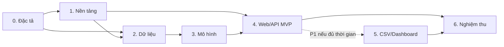

# Lộ trình phát triển Student Feedback AI

**Nguồn yêu cầu:** [BRD](../../README.md).  
**Ngày lập:** 2026-10-18.  
**Trạng thái:** Đã phân rã công việc; các phase chưa triển khai.

Tài liệu chia dự án thành các phase để theo dõi phát triển và nghiệm thu. Đây là lộ trình cấp dự án; thiết kế chi tiết và kế hoạch lập trình từng bước được hoàn thiện khi bắt đầu mỗi phase, dựa trên đầu ra thực tế của phase trước.

## 1. Cơ sở lập kế hoạch

- Theo BRD: nhóm 06 sinh viên, thời gian dự kiến 21 ngày, hai nhiệm vụ sentiment/topic, mỗi nhiệm vụ trả một nhãn chính.
- Ngày trong bảng là ngày tương đối kể từ lúc nhóm bắt đầu, chưa phải lịch cam kết theo ngày tháng.
- Ưu tiên P0: dữ liệu hợp lệ, so sánh ba thuật toán cho mỗi nhiệm vụ, hai pipeline thật, web phân tích một câu, kiểm thử và báo cáo.
- P1 gồm CSV, xuất kết quả và Dashboard; có thể bỏ Phase 5 để bảo vệ thời gian nghiệm thu.
- P2 như ABSA, PhoBERT, tài khoản, database và cloud chưa nằm trong lộ trình này.
- Repository hiện có bộ tài liệu và quy tắc cộng tác; các đường dẫn sản phẩm trong từng phase là dự kiến, chưa phải mã ứng dụng đã triển khai.

## 2. Cách tổ chức công việc

Leader tự chốt Phase 0. Năm thành viên phụ trách độc lập Data, Sentiment, Topic, Backend và Frontend trên năm nhánh chức năng; xem [quyền sở hữu file](../function-ownership.md). Các phase mô tả mốc thời gian/kiểm chứng, không yêu cầu nhiều người cùng sửa một file.

Mỗi phần bàn giao qua hợp đồng và PR vào `develop`. Backend/Frontend có thể chuẩn bị theo đặc tả trong lúc Data/ML thực hiện; tích hợp cuối phải dùng pipeline thật. Các file chung do leader sở hữu để hạn chế xung đột.

## 3. Tổng quan các phase

| Phase | Thời gian dự kiến | Đầu ra chính | Phụ thuộc | Phụ trách chính | Trạng thái |
| --- | --- | --- | --- | --- | --- |
| [0 — Chốt phạm vi và đặc tả](phase-0-specification.md) | Ngày 1 | Đặc tả đầu vào, nhãn, API và tiêu chí nghiệm thu | BRD | TV1 tự chốt | Chờ leader chốt |
| [1 — Nền tảng dự án](phase-1-foundation.md) | Ngày 2–3 | Môi trường chạy được, khung ứng dụng và kiểm thử | Phase 0 | TV5, TV6, TV1 | Chưa bắt đầu |
| [2 — Dữ liệu và tiền xử lý](phase-2-data.md) | Ngày 3–6 | Dataset được xác minh, EDA, tiền xử lý dùng chung | Phase 0; môi trường Phase 1 | TV2 | Chưa bắt đầu |
| [3 — Huấn luyện và đánh giá](phase-3-models.md) | Ngày 6–10 | So sánh 6 cấu hình thuật toán/nhiệm vụ, xuất 2 pipeline đã chọn | Phase 2 | TV3, TV4 | Chưa bắt đầu |
| [4 — API và website MVP](phase-4-mvp.md) | Ngày 11–14 | Nhập câu mới trên web, nhận 2 nhãn từ mô hình thật | Phase 1, Phase 3 | TV5, TV6, TV1 | Chưa bắt đầu |
| [5 — CSV và Dashboard, P1](phase-5-batch-dashboard.md) | Ngày 15–17, nếu đủ thời gian | Phân tích hàng loạt, xuất dữ liệu, thống kê | Phase 4 đạt; đủ thời gian cho Phase 6 | TV5, TV6 | Chưa bắt đầu — tùy chọn |
| [6 — Nghiệm thu và bàn giao](phase-6-delivery.md) | Ngày 15–21 | Kiểm thử tổng thể, hướng dẫn tái lập, báo cáo và slide | Phase 4; thêm Phase 5 nếu triển khai | TV1, cả nhóm | Chưa bắt đầu |

Phase 2 có thể bắt đầu xác minh nguồn ngay sau Phase 0. TV5/TV6 có thể chuẩn bị API/UI theo đặc tả trong Phase 2–3; Phase 4 vẫn cần minh chứng tích hợp với mô hình thật. Thu thập nội dung báo cáo từ Phase 2; Phase 6 tổng hợp và kiểm chứng cuối cùng.

## 4. Quy tắc chuyển phase

1. Hoàn thành checklist và lưu bằng chứng theo tiêu chí đầu ra của phase.
2. Chạy các kiểm tra liên quan; ghi lệnh chạy, kết quả và vấn đề còn tồn tại vào tài liệu phase.
3. Rà soát yêu cầu BRD tương ứng; không đánh dấu đạt chỉ vì đã tạo đủ file.
4. Cập nhật trạng thái trong bảng: Chưa bắt đầu → Đang thực hiện → Đã đạt; dùng Bị chặn khi thiếu điều kiện, hoặc Bỏ qua cho Phase 5.
5. Nếu đầu vào hoặc giao diện thay đổi, cập nhật đặc tả và các phase phụ thuộc trước khi tích hợp.

## 5. Liên kết nghiệm thu với BRD

| Tiêu chí BRD | Phase chịu trách nhiệm cung cấp minh chứng |
| --- | --- |
| AC-01 — Nguồn dữ liệu, bảng mã, chia tập, EDA | Phase 2 |
| AC-02 — So sánh thuật toán và đánh giá ML | Phase 3 |
| AC-03 — Website dự đoán qua pipeline thật | Phase 4 |
| AC-04 — Đầu vào rỗng và thiếu mô hình | Phase 4; khởi tạo kiểm tra ở Phase 1 |
| AC-05 — CSV và xuất kết quả | Phase 5, nếu triển khai |
| AC-06 — Thống kê Dashboard | Phase 5, nếu triển khai |
| AC-07 — Trạng thái dịch vụ/mô hình | Phase 1 và Phase 4 |
| AC-08 — Tái lập, bảo vệ dữ liệu và bàn giao học phần | Phase 6, thu thập bằng chứng từ các phase trước |

## 6. Điểm bắt đầu

Bắt đầu bằng [Phase 0](phase-0-specification.md): rà soát các mục TBD trong BRD, xác định quyết định nào chặn MVP, rồi ghi đặc tả để TV2–TV6 có cùng đầu vào triển khai. Không tự đặt ngưỡng Accuracy/F1 hoặc chuyển P1 thành cam kết P0.
