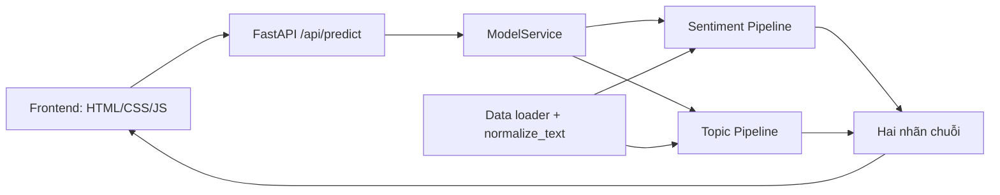

# Đặc tả MVP v1.0

**Ngày soạn:** 2026-10-19. **Trạng thái:** Đề xuất để leader duyệt; các quyết định dưới đây cụ thể cho phiên bản 1.0, chưa phải minh chứng triển khai.

## 1. Mục đích và người dùng

Ứng dụng demo học phần cho người đánh giá/nhóm dự án nhập phản hồi sinh viên bằng tiếng Việt và xem một nhãn cảm xúc cùng một nhãn chủ đề. Nhãn hỗ trợ xem xét phản hồi; con người chịu trách nhiệm diễn giải. Không có tài khoản, lưu lịch sử hoặc database trong MVP.

| Ưu tiên | Phạm vi |
| --- | --- |
| P0 — cam kết | Xác minh UIT-VSFC, EDA/tiền xử lý, ba thuật toán cho mỗi nhiệm vụ, hai pipeline đã chọn, API/web phân tích một câu, health/lỗi, tests, report và slide |
| P1 — chỉ làm khi leader cho phép | Tải CSV, kết quả từng dòng, xuất CSV, Dashboard phân bố nhãn của tập vừa phân tích |
| P2 — ngoài bản này | PhoBERT/Deep Learning, ABSA, chatbot/LLM, database, đăng nhập, lịch sử, production/cloud |

Số liệu chất lượng ML được đo và phân tích thực tế; v1.0 không đặt thêm ngưỡng Accuracy/F1 tối thiểu. Không đưa P1 vào tiêu chí P0 vì file P1 đã được tạo sẵn.

## 2. Kiến trúc và ranh giới

FastAPI có biến `app` ở `backend/main.py`, đăng ký `/api/*` và `/docs` trước static frontend. Frontend phục vụ tại `/`, assets lấy từ thư mục `frontend/`; API được gọi bằng URL tương đối `/api/health` và `/api/predict`. Demo một server tại `127.0.0.1:8000`, một worker, không dùng CDN hoặc dịch vụ ML ngoài.

Data sở hữu loader/nhãn/chuẩn hóa. Sentiment và Topic sở hữu code/metrics/artifact riêng. Backend chỉ tải pipeline và gọi predict; không tự viết lại Data hay huấn luyện. Frontend chỉ hiển thị dữ liệu API, không dự đoán hoặc hard-code nhãn. Leader sở hữu đặc tả, config/dependencies gốc và tests tích hợp. Chi tiết ở [quyền sở hữu file](../function-ownership.md).

## 3. Luồng giao diện P0

1. Trang mở, gọi health. Dịch vụ chưa kết nối được hiển thị lỗi kết nối; thiếu model hiển thị Chưa sẵn sàng, giữ vùng nhập để người dùng không mất nội dung.
2. Người dùng nhập câu. Form hiển thị bộ đếm Unicode code point (`[...text].length`), kiểm tra khoảng trắng và giới hạn 5000; không dùng riêng HTML `maxlength` như phép đếm chuẩn vì nó tính UTF-16 code unit.
3. Nút Phân tích chỉ gửi khi input hợp lệ, không đang gửi và health đã sẵn sàng. Trong lúc gửi, khóa nút và hiển thị Đang phân tích.
4. Gửi nguyên giá trị `text`, không bỏ dấu/viết thường/chuẩn hóa lại tại UI. Backend xác thực; pipeline xử lý chuẩn hóa đúng một lần.
5. Thành công: hiển thị hai nhãn tiếng Việt bằng bảng ánh xạ trong [API](api-contract.md). Không có confidence hoặc phần trăm giả.
6. 422: hiển thị lỗi nhập liệu; 503: model chưa sẵn sàng; 500: lỗi hệ thống; lỗi mạng/timeout: thông báo và cho phép thử lại. Giữ nội dung đã nhập và bỏ trạng thái kết quả cũ khi yêu cầu mới thất bại.

Frontend dùng `textContent` để hiển thị văn bản/thông báo. Timeout client 10000 ms bằng AbortController, không tự gửi lại yêu cầu; đây là hành vi UX, không phải cam kết server luôn xử lý dưới 10 giây. Chrome và Edge desktop phiên bản stable tại thời điểm nghiệm thu là trình duyệt mục tiêu; ghi phiên bản thực tế trong minh chứng.

## 4. Khởi động và lỗi model

Backend khởi động được khi chưa có model, vẫn phục vụ UI/docs/health. Mỗi task có trạng thái ready/missing/invalid. Chỉ khi cả hai ready mới chấp nhận suy luận; không trả kết quả nửa chừng nếu thiếu một model.

Artifact được kiểm tra metadata, phiên bản thư viện, checksum và tập nhãn trước khi dùng. Nếu lỗi khởi động một task, task đó invalid, health báo chưa sẵn sàng. Không tự tải artifact từ URL và không thay bằng nhãn mẫu. Để đơn giản demo, thay artifact rồi khởi động lại ứng dụng; v1.0 không có hot reload model.

## 5. Thí nghiệm

Giữ nguyên ba split chính thức, chuẩn hóa trong pipeline, so sánh Multinomial NB/Logistic Regression/Linear SVM cho mỗi nhiệm vụ. Chọn bằng validation trước khi đọc điểm test cuối; đánh giá test cho ba cấu hình đã đóng băng, không dùng test để đổi cấu hình hoặc đổi mô hình thắng. Chi tiết tham số và tie-break ở [Data/model](data-contract.md).

Hai pipeline lưu toàn bộ TF-IDF + classifier, trả nhãn chuỗi chuẩn. Có manifest dữ liệu, metrics, confusion matrix, lỗi mẫu, metadata artifact và log tải lại. Các chỉ số tham khảo của nguồn không phải kết quả của dự án.

## 6. Làm song song và mốc bàn giao

| Mốc | Điều kiện/đầu ra | Người nhận |
| --- | --- | --- |
| M0 | Leader duyệt bộ hợp đồng v1.0 | Cả 5 người bắt đầu code/tests phần riêng |
| M1 | Nguồn/quyền dùng, nhãn/split, loader/chuẩn hóa có tests và manifest đã duyệt | Sentiment/Topic train thật; Data tiếp tục EDA/báo cáo |
| M2-S / M2-T | Pipeline/metadata, metrics, tests tải lại, cách nhận artifact đúng quyền | Backend; hai mô hình bàn giao độc lập |
| M3 | API health/predict chạy hai model thật, đúng JSON/lỗi | Frontend tích hợp thật |
| M4 | Câu mới chạy UI → API → hai pipeline, có log/ảnh | Leader nghiệm thu và xét bản đưa lên main |

Trước M1, hai người mô hình viết pipeline/tests bằng fixture nhỏ. Backend viết validation/health/lỗi và unit tests với test double trước M2. Frontend dựng UI và test bằng fixture được nhận diện rõ trước M3. Fixture/mock không xuất hiện như dự đoán thật trên bản nghiệm thu và không dùng làm metrics nghiên cứu.

## 7. Nghiệm thu và bàn giao

| BRD | Điều kiện kiểm tra v1.0 | Minh chứng |
| --- | --- | --- |
| AC-01 | Nguồn/quyền sử dụng, số dòng/mã nhãn/split và EDA được đối chiếu | docs/data, notebook, manifest, tests Data |
| AC-02 | Ba thuật toán/nhiệm vụ, chọn validation, test cuối và phân tích lỗi thật | Hai bộ metrics/figures, cấu hình, metadata, tests model |
| AC-03 | Câu mới qua UI/API/hai artifact thật; nhãn API khớp gọi pipeline trực tiếp | Log, ảnh/trình duyệt và tests/integration |
| AC-04 | 422 cho input sai, 503 cho thiếu/hỏng model; UI hiển thị đúng | Tests API và tests UI |
| AC-05 | Chỉ áp dụng khi P1 được leader cho phép; CSV đúng hợp đồng | File mẫu/xuất và tests batch |
| AC-06 | Chỉ áp dụng khi P1 được phép; biểu đồ khớp số dòng thành công | Đối chiếu summary/bảng/UI |
| AC-07 | Health luôn phân biệt live với ready, đủ/thiếu/hỏng model | Tests health và phản hồi thực tế |
| AC-08 | Môi trường khóa phiên bản, hướng dẫn tái lập, code/report/slide và đóng góp thật | Bảng nghiệm thu, log, report/slide cuối kỳ |

Không coi test rỗng, bài bị skip hoặc ảnh mock là đạt. Ghi thời gian suy luận thực tế trên máy demo; chưa đặt SLA, số người dùng đồng thời hoặc cam kết production. Report theo 6 phần học thuật và tối đa 80 trang như BRD; lịch nộp/thuyết trình do leader xác nhận với giảng viên.
