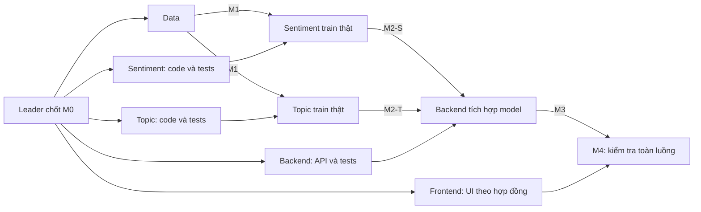

# Phân công 5 thành viên và kế hoạch làm song song

**Cập nhật:** 2026-10-19. **Trạng thái:** Đã chuẩn bị khung trống; Phase 0 chờ leader chốt, sản phẩm chưa được triển khai.

## 1. Một người phụ trách trọn một chức năng

| Vai trò | Nhánh | Đầu mối hướng dẫn | Công việc trọn phần |
| --- | --- | --- | --- |
| TV1 — Leader | Điều phối PR và file chung | [Phase 0](phase-0-leader-checklist.md) | Chốt đặc tả, môi trường chung, review, tích hợp, nghiệm thu và tổng hợp báo cáo |
| TV2 — Data | `feature/data-preprocessing` | [Hướng dẫn Data](data/README.md) | Dataset, EDA, loader, chuẩn hóa, bảng nhãn và tests Data |
| TV3 — Sentiment | `feature/sentiment-model` | [Hướng dẫn Sentiment](sentiment/README.md) | Training/evaluation/inference, pipeline và báo cáo cảm xúc |
| TV4 — Topic | `feature/topic-model` | [Hướng dẫn Topic](topic/README.md) | Training/evaluation/inference, pipeline và báo cáo chủ đề |
| TV5 — Backend | `feature/backend-api` | [Hướng dẫn Backend](backend/README.md) | FastAPI, health, predict, nạp model, tests API; batch nếu làm P1 |
| TV6 — Frontend | `feature/frontend-dashboard` | [Hướng dẫn Frontend](frontend/README.md) | HTML/CSS/JS, giao diện, gọi API, tests UI; CSV/Dashboard nếu làm P1 |

Leader điền tên/tài khoản và hạn thực tế khi giao việc. Năm nhánh chứa cùng cấu trúc dự án để tích hợp được, mỗi người chỉ sửa phạm vi của mình theo [quyền sở hữu file](function-ownership.md). Danh sách chính xác các file khởi đầu nằm trong [manifest](scaffold-manifest.json).

## 2. Bắt đầu đồng thời

Sau khi leader chốt hợp đồng Phase 0, cả năm người bắt đầu cùng lúc:

| Thành viên | Làm ngay, không cần chờ người khác hoàn thành | Chỉ bước này cần đầu ra thật |
| --- | --- | --- |
| Data | Xác minh nguồn/nhãn/split, loader, chuẩn hóa và kiểm tra dữ liệu | Tự xác minh nguồn trước khi bàn giao dữ liệu thật |
| Sentiment | Viết pipeline, cấu hình NB/LR/SVM, mã đo/lưu-tải và tests bằng fixture nhỏ | Huấn luyện/đánh giá thật cần gói Data đã duyệt |
| Topic | Viết pipeline và tests chủ đề độc lập với Sentiment | Huấn luyện/đánh giá thật cần gói Data đã duyệt; không chờ Sentiment |
| Backend | Khung API, schema, validation, health, lỗi thiếu model và unit tests | Kiểm chứng dự đoán thật cần hai pipeline được duyệt |
| Frontend | Form nhập, bố cục, trạng thái loading/error/result và gọi API theo hợp đồng | Kiểm thử toàn luồng cần API/model thật |

Fixture/mock dùng riêng cho kiểm thử và phát triển giao diện phải nhận diện rõ, không đưa vào API thật để giả làm kết quả mô hình. Không dùng số liệu từ fixture làm metrics nghiên cứu.

## 3. Bàn giao theo mốc nhỏ

| Mốc | Người bàn giao | Nội dung tối thiểu | Người nhận |
| --- | --- | --- | --- |
| M0 — Hợp đồng | Leader | Data schema, API JSON/lỗi, giao diện artifact và phiên bản môi trường | Cả 5 thành viên |
| M1 — Data dùng được | Data | Nguồn được xác minh, split/bảng nhãn, loader/chuẩn hóa có tests và manifest | Sentiment, Topic |
| M2-S — Model cảm xúc | Sentiment | Pipeline + metadata, hướng dẫn tải, tests và metrics thật | Backend, leader |
| M2-T — Model chủ đề | Topic | Pipeline + metadata, hướng dẫn tải, tests và metrics thật | Backend, leader |
| M3 — API dùng được | Backend | Health/predict theo hợp đồng, lỗi rõ ràng và hướng dẫn chạy | Frontend |
| M4 — Luồng thật | Frontend + leader kiểm tra | Giao diện gọi API/model thật, minh chứng nghiệm thu | Leader |

Data bàn giao M1 sớm; tiếp tục EDA/biểu đồ/báo cáo trong khi hai mô hình huấn luyện. Hai M2 độc lập, không phải đợi nhau mới viết code. Backend có thể bàn giao khung/lỗi trước M2, rồi xác nhận M3 chạy model thật khi đủ artifact.

## 4. Issue khởi đầu và cách làm việc

Leader tạo/gán TEAM-01 Data, TEAM-02 Sentiment, TEAM-03 Topic, TEAM-04 Backend, TEAM-05 Frontend. Mỗi Issue có tên người nhận, hạn thực tế, file được sửa và tiêu chí nghiệm thu theo hướng dẫn vai trò. Các Issue này chưa được tự động đăng hoặc gửi cho thành viên.

Mỗi người mở nhiều PR nhỏ vào `develop`, leader duyệt trước khi merge. Đồng bộ phần đã được duyệt qua `origin/develop`; không chép code hay tự merge trực tiếp nhánh của người khác. Bản tích hợp ổn định mới mở PR `develop` → `main`.

Leader giữ file chung; mỗi thành viên cập nhật dependencies trong file riêng và viết phần báo cáo trong thư mục tài liệu riêng. Xem [hướng dẫn bắt đầu](team-start.md) và [CONTRIBUTING](../CONTRIBUTING.md).
